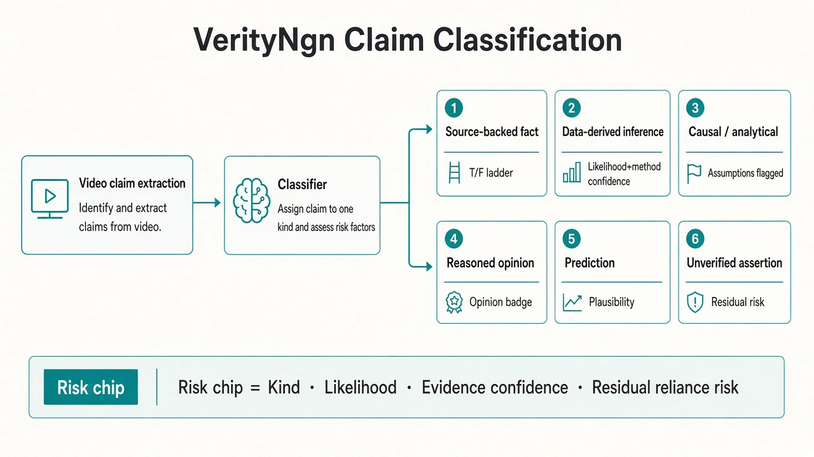
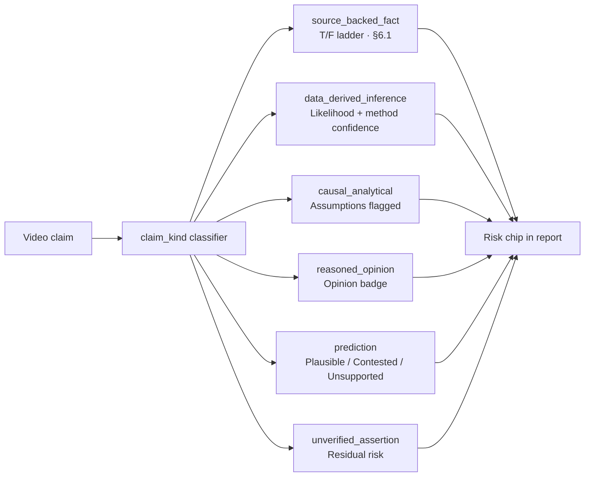

# When Truth Isn’t Just True/False: Categorical–Probabilistic Risk Measures for Analyst Videos

**VerityNgn OSS enhancement · September–October 2026**  
**Fixture:** Chris Schuermyer — Oregon SB 1507 deep-data analysis  
**Live release dir:** `outputs/release_v3_sb1507` (after local-full run) · offline smoke: `finish_smoke_sb1507`  
**Candidate SHA:** `5258292` on `release/v3.0.0`  
**Audience:** Creators like Chris, product reviewers, and readers of the VerityNgn OSS engine

---

## TL;DR for Chris

Your video isn’t a string of “true or false” headlines. It’s a mix of **checkable facts**, **method-backed dollar/% analysis**, **causal legislative logic**, and a few **forward-looking** or **biographical** statements.

VerityNgn now **labels each claim by type**, then shows a one-line **risk chip**:

> *Data-derived inference · Leaning True · Evidence: High · Residual reliance risk: Medium*

So a viewer can skim typed sections and see that reasoned data analysis is assessed with **likelihood + evidence confidence + residual risk** — not dumped into “uncertain/false because no journal cite.”

| Before (4 thin sleeves) | After (6 Full Fact / ICD-aligned kinds) |
|---|---|
| 26/28 claims on dense T/F ladder | **13/28** source-backed facts in §6.1 |
| Forecast language → “opinion” | Forecasts → **prediction** (plausibility) |
| MinHash / LRO $ → scored like news facts | Method/$/% → **data_derived_inference** |
| Missing URL ≈ “needs deeper research” noise | Deeper sleeve reserved for causal / incomplete paths |



*Figure 1. Classification flow from video claim → kind → verification mode → risk chip.*

---

## How risk chips get into the report

Risk chips are **not** a post-hoc blog decoration. They are first-class metadata on each claim, then rendered into markdown/HTML.

```text
Claim text
   │
   ▼
classify_claim_kind()          → claim_kind, verification_lane
   │
   ▼
verify_claim() + search        → likelihood (TRUE/FALSE/UNCERTAIN bands, or plausibility/opinion)
   │
   ▼
_stamp_lane_on_verified_claim()
   ├── evidence_confidence     (Low / Medium / High — method transparency + source agreement)
   ├── residual_reliance_risk  (after verification)
   ├── abatement_notes         (what reduced risk)
   └── risk_chip               (one-liner for the report card)
   │
   ▼
reporting.py → Claim(... risk_chip=...)
   │
   ▼
markdown_generator.py
   ├── §6.1  source_backed_fact only  (classic T/F table)
   └── §6.3–6.8 typed sections with a “Risk chip” column
```

**Code path (OSS `release/v3.0.0`):**

| Stage | File | What happens |
|---|---|---|
| Classify | `verityngn/workflows/claim_kind.py` | Six kinds + legacy aliases |
| Stamp | `verityngn/workflows/verification.py` → `_stamp_lane_on_verified_claim` | Builds `risk_chip` string onto `verification_result` |
| Model | `verityngn/models/report.py` → `Claim.risk_chip` | Carried into typed report objects |
| Render | `verityngn/services/report/markdown_generator.py` | `_risk_chip_for()` fills the Risk chip column in §§6.3–6.8 |
| Deep Research | `verityngn/services/deepresearch/sanitize.py` | Passes `risk_chip` / confidence / residual risk into DR input |

**Chip pattern:**

```text
{Kind label} · {Likelihood or plausibility} · Evidence: {Low|Medium|High} · Residual reliance risk: {Low|Medium|High}
```

### Important for this Chris review pack

The Sep 23 smoke files under `outputs/finish_smoke_sb1507/` (`report.html`, `report.md`) were **rendered before** this taxonomy landed. They still show the old §6.3 “deeper research” sleeve.

What you should open for this review:

| Artifact | Purpose |
|---|---|
| `outputs/release_v3_sb1507/*_report.html` | **Live** local-full report with chips + SIFT §9 (preferred for joint review) |
| [`chris_review_typed_sections.md`](../../outputs/sb1507_risk_taxonomy_loop/chris_review_typed_sections.md) | Offline re-stamp preview of typed sections |
| [`scorecard.json`](../../outputs/sb1507_risk_taxonomy_loop/scorecard.json) | Acceptance metadata + every claim’s chip |
| Zip | `outputs/chris_sb1507_review_package.zip` |
| Original `finish_smoke_sb1507/report.html` | Sep 23 narrative (pre-taxonomy layout) |

Live `verityngn analyze --tier local-full` writes chips into `report.md` / `report.html` via the path above.

---

## Why we changed this (Sherlock finding)

Chris-style videos are **analyst products**: clustering of testimony, LRO revenue bridges, on-screen $ graphics, rolling-conformity logic, implementation timelines. Treating all of that as “sourceable fact or bust” produced:

1. **Density** — all 28 claims in one T/F table.  
2. **Mis-tags** — “forecast” language punished as opinion.  
3. **Wrong evidence bar** — method claims looking “false/uncertain” when the real issue was “no academic URL,” not a failed recompute.  
4. **Noisy deeper-research** — missing URL conflated with “author proof deserves respect.”

Research defaults we adopted (not reinvented):

- **ICD 203 / IPCC** — separate *likelihood of the assessment* from *confidence in the evidence backing*.  
- **Full Fact typology + ClaimBuster + Toulmin** — fact / value / policy / prediction lanes.  
- **SIFT / lateral reading** over CRAAP-as-primary for this genre.  
- **Basel-style residual risk** — what remains if a viewer still relies on the claim after our pass.

We kept existing TRUE/FALSE/UNCERTAIN numerics for **`source_backed_fact` only**. We did **not** rewrite the whole verifier.

---

## The six kinds (classification diagram)



| Kind | Verification mode | Report home |
|---|---|---|
| `source_backed_fact` | Classic counter-intel + sources | §6.1 core histogram |
| `data_derived_inference` | Method + data provenance; **do not discount solely for missing academic cites** | §6.3 |
| `causal_analytical` | Assumptions flagged; confidence capped unless strong data | §6.4 (+ §6.8 if incomplete) |
| `reasoned_opinion` | Premises only; never true/false the value | §6.6 |
| `prediction` | Plausibility of futures — not LIKELY_FALSE just for being future-dated | §6.5 |
| `unverified_assertion` | Check-worthy, thin public evidence | §6.7 |

Legacy names (`factual_sourceable`, `author_proof_candidate`, `opinion_or_synthesis`) still normalize as aliases for one release.

---

## Chris / sb1507 results (offline re-categorize)

**Fixture:** `outputs/finish_smoke_sb1507` · 28 claims · scorecard `all_green: true`

| Kind | Count |
|---|---:|
| Source-backed fact (§6.1) | 13 |
| Data-derived inference | 7 |
| Causal / analytical | 4 |
| Prediction | 2 |
| Unverified assertion | 2 |
| Reasoned opinion | 0 |

**Acceptance gates**

| Gate | Result |
|---|---|
| ≥60% of quantitative/method claims → `data_derived_inference` | **83.3%** |
| §6.1 rows ≤ half of total claims | **13/28** |
| Deeper sleeve not dominated by generic UNCERTAIN facts | pass |
| Zero predictions labeled LIKELY_FALSE solely for being future-dated | pass |
| Offline unit tests (classifier + dual metrics + tL factual ladder) | **11 passed** |

### Sample risk chips Chris can walk line-by-line

**Data-derived (core of the genre)**

- Clustering / MinHash-style testimony:  
  `Data-derived inference · Uncertain · Evidence: High · Residual reliance risk: Medium`
- LRO bridge $342.3M vs credits:  
  `Data-derived inference · Uncertain · Evidence: High · Residual reliance risk: Medium`
- Preliminary LRO ~$749.2M across biennia:  
  `Data-derived inference · Leaning True · Evidence: High · Residual reliance risk: Medium`
- On-screen $162,810,553 graphic:  
  `Data-derived inference · Uncertain · Evidence: High · Residual reliance risk: Medium`

**Causal / analytical**

- ORS 250.125(4) model mandate vs ordinary bills:  
  `Causal / analytical · Uncertain · Evidence: Medium · Residual reliance risk: High`

**Prediction**

- Implementation timelines (spring 2027–2029 actuals):  
  `Prediction · Uncertain · Evidence: Medium · Residual reliance risk: Medium`

**Still on the factual ladder (as they should be)**

- Senate/House final votes, governor signature date, constitution revenue-bill origin rules, hearing timestamps — these stay in **§6.1** with classic verdicts.

Full tables: [`chris_review_typed_sections.md`](../../outputs/sb1507_risk_taxonomy_loop/chris_review_typed_sections.md).

---

## Dual metrics, in plain language (for the blog and for Chris)

Never mash these into one phrase:

1. **Likelihood / assessment** — how strongly the engine leans true/false/uncertain (or “plausible” for futures, “opinion” for values).  
2. **Evidence confidence** — how solid the *backing for that judgment* is (method transparency, source agreement) — **not** “how many peer-reviewed papers.”  
3. **Residual reliance risk** — if a viewer still *acts on* this claim after our pass, how risky is that? Correctly flagged false claims abate reliance risk; thin method claims with high stakes may stay medium/high residual.

That’s why a data-derived LRO figure can read **Leaning True · Evidence: High · Residual: Medium** instead of collapsing into a single “uncertain because no journal.”

---

## What stayed the same (tL / consumer factual videos)

Promo / clinical / checkable-claim videos still get the dense TRUE/FALSE ladder for source-backed facts. Unit regression (`test_tl_style_factual_ladder_still_core`) locks that path. This enhancement is **additive genre routing**, not a rewrite of VerityNgn’s counter-intelligence core.

---

## Review agenda with Chris (30–40 minutes)

1. Open Figure 1 (classification) — align on the six kinds in his language.  
2. Skim §6.1 facts only — “these are the newspaper facts.”  
3. Walk §6.3 data-derived chips — “this is my product; judge method, don’t demand a paper.”  
4. Glance §6.4 / §6.5 — assumptions and futures called out honestly.  
5. Compare to old `report.html` density — confirm relief without losing rigor.  
6. Feedback ask: any claim mis-binned? any chip wording that would confuse a non-technical viewer?

---

## Engineer notes / reproducibility

```bash
# Offline re-categorize + acceptance scorecard (no video re-download)
python scripts/sb1507_risk_taxonomy_scorecard.py

# Outputs
#   outputs/sb1507_risk_taxonomy_loop/scorecard.json
#   outputs/sb1507_risk_taxonomy_loop/chris_review_typed_sections.md
#   outputs/sb1507_risk_taxonomy_loop/chris_review_restamped_report.json
```

Plan (supersedes thin author_proof first slice):  
`~/proj/plans/verityngn-oss/analyst_risk_claim_taxonomy_2026-09-25.plan.md`

Out of scope for this slice (later): author-uploaded evidence packets; full ICD percentage UI for consumers; commercial batch promote.

---

## Closing

Analyst videos deserve a report grammar that matches how analysts actually speak: **facts, methods, causes, opinions, predictions**. VerityNgn OSS now carries that grammar into claim metadata and into the report itself via risk chips — so Chris can show a viewer not only *what we think*, but *how sure we are of the backing*, and *what risk remains if you rely on it*.

*HotChili Analytics / VerityNgn Research · OSS engine on `release/v3.0.0`*
