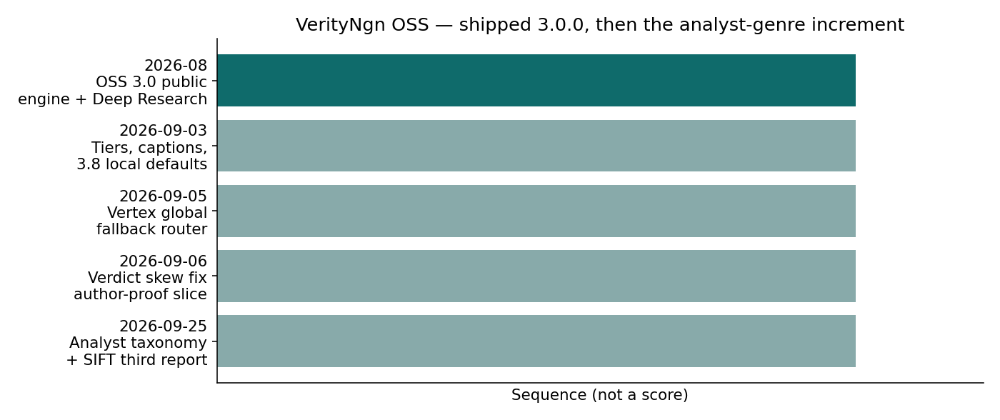

# Part 1 — What VerityNgn is, and how the engine got here

**Series:** VerityNgn OSS  
**Part 1 of 4 · History and mission**

---

## The job

Take a video. Extract the claims a viewer might rely on. Check them against outside evidence, including evidence that contradicts the speaker. Publish a report that says how strong that check was — and what risk remains if someone still acts on the claim.

That is the OSS engine. It is not a lie detector, and it is not an earnings model. Predictions and risk-factor products stay outside this repository. The public engine is the thing those products are supposed to stand on.

## What “multimodal” and “counter-intelligence” mean here

A transcript-only checker misses charts, on-screen dollar figures, and lower-thirds. VerityNgn’s analysis path is built to read video, audio, and on-screen text, then fuse claims across the timeline.

Counter-intelligence means the verifier looks for contradiction, not a supporting quote. Press-release and self-promotional pages are down-weighted. Government domains are not treated as press releases just because they announce something.

The report’s ordinal bands stay familiar: highly likely true through highly likely false, plus uncertain. Those bands are an assessment of the claim given the evidence in hand. They are not a probability that the speaker is a liar.

## A short history of the public engine

*Figure. Sequence of the public engine through September 2026. Bar length is not a score; color marks the latest increment.*

| When | What landed |
|---|---|
| 2026-08-29 | OSS **3.0.0** public cut: Deep Research back in the Apache tree, authenticity stubs, open-core boundary (predictions stay closed). |
| 2026-09-03 | Analysis tiers (`light` / `full` / `auto`), caption fallbacks, local `report.html` + `deep.html`, Gemini 3.8 as the local default. |
| 2026-09-05 | Shared Vertex fallback: prefer `global` on Gemini 3.8, then lower models, then `us-central1`, then a Developer API key if one is set. |
| 2026-09-06 | Verdict-key cleanup so “uncertain” is not counted as support. First thin sleeves for author-proof and opinion. |
| 2026-09-25 | Analyst-video taxonomy: six claim kinds, dual risk metrics, SIFT genre §9. |
| 2026-10-03 | Freeze commit `5258292` on `release/v3.0.0` as the 3.0.0 release candidate (tag still at August SHA until matrix green). |

The published package version in `pyproject.toml` is **3.0.0**. The analyst-genre work is part of that candidate. It is not a separate tagged 5.0.0.

## Why a new grammar was needed

The 3.0 report assumed a consumer video: checkable sentences, outside sources, a CRAAP table (Currency, Relevance, Authority, Accuracy, Purpose) for those sources.

An analyst video — legislative revenue bridges, clustering of testimony, on-screen dollar graphics — is a different product. Most of its sentences are **calculations and arguments**, not newspaper facts. Scoring all of them on one true/false ladder, and grading the video with a library CRAAP test, hides the work the analyst actually did.

Part 2 describes the features. Part 3 states the candidate SHA and tag rules. Part 4 names the two demo videos.

---

*Next: [Part 2 — Features and value](02-features-and-value.md)*
