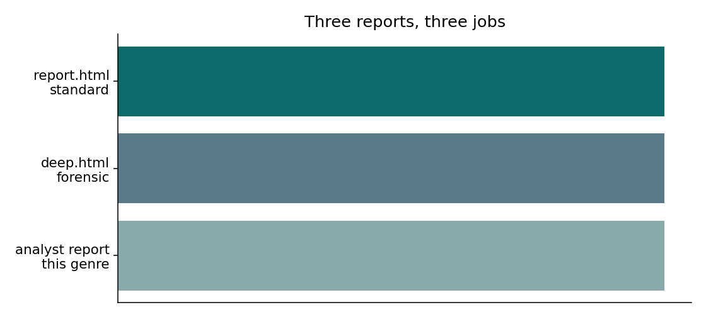

# Part 2 — Features and value: three reports, six claim kinds

**Series:** VerityNgn OSS, three parts  
**Part 2 of 3 · Features and value**

---

## One video, three reports

| Report | Job | When it fits |
|---|---|---|
| `report.html` | Standard claim ladder, sources, counter-intelligence | Every video. CRAAP stays here when the mix is mostly checkable facts. |
| `deep.html` | Grounded forensic pass over the standard report | When you want a second model to stress the binder and the cites. |
| **Analyst report** (new) | Typed sections + risk chips + **SIFT method review** | When at least about a quarter of claims are data-derived, causal, or predictive. CRAAP is not the primary section. |

The analyst report does not replace the other two. It is the view you hand a creator whose product is the analysis itself.

## Six kinds, not one ladder

| Kind | What the viewer should take it as |
|---|---|
| Source-backed fact | A checkable event, vote, date, or statute line. Full true/false ladder. |
| Data-derived inference | A number that comes from a method (clustering, LRO bridge, on-screen modeled total). Likelihood plus evidence confidence. Missing journal cites do not by themselves make it false. |
| Causal / analytical | An argument (“because rolling conformity, therefore…”). Assumptions stay visible. |
| Reasoned opinion | A value (“should”, “in my view”). Not scored true or false. |
| Prediction | A future (spring 2027 actuals, “will raise”). Plausible, contested, or unsupported — not false merely because it has not happened. |
| Unverified assertion | Check-worthy color with thin public evidence. Residual risk stays high. |

## What changed on the Chris / SB1507 smoke

Twenty-eight claims, re-labeled from the existing verification file. The video was not re-run.

*Figure. Claims sitting on the core true/false table. Before: 26 of 28. After: 13 of 28. The other 15 move to typed lanes.*

*Figure. Kind mix after re-categorization. Source: `outputs/sb1507_risk_taxonomy_loop/scorecard.json`.*

Acceptance on that re-stamp: 83% of quantitative method claims landed in data-derived inference; the fact table is at most half the claims; no prediction was labeled likely-false only for being in the future.

## The risk chip

Each non-fact card carries one line, and the pieces are not mashed together:

`Data-derived inference · Leaning True · Evidence: High · Residual reliance risk: Medium`

- **Likelihood** — the ordinal band (or plausibility / opinion).
- **Evidence confidence** — Low, Medium, or High on the *backing for that judgment* (method named, sources agree). Not “how many papers.”
- **Residual reliance risk** — if a viewer still acts on the claim after the pass, how exposed are they?

## SIFT instead of CRAAP, for this genre

CRAAP asks whether a *source* is current, relevant, authoritative, accurate, and fit for purpose. That is the right question for a health claim backed by a webpage.

For an analyst video the better questions are the SIFT moves:

1. **Stop** — do not treat the modeled number as a news fact.
2. **Investigate** — who computed it, and is the method named?
3. **Find better coverage** — the revenue impact PDF, the bill text, the hearing record.
4. **Trace** — can the on-screen dollar figure be walked back to a dated artifact?

When the claim mix crosses the analyst threshold, section 9 of a newly generated markdown report is this review. Consumer videos still get CRAAP.

## Value, stated narrowly

A creator can show a viewer the difference between “the Senate voted 17–12” and “our clustering says 66.7% of distinct testimonies opposed the disconnect.” A reviewer can argue with the bin and the chip without arguing that the whole video is “uncertain.” A later Deep Research pass can prioritize causal and incomplete paths instead of every missing URL.

---

*Previous: [Part 1 — History](01-history-and-mission.md) · Next: [Part 3 — Where the release stands](03-where-the-release-stands.md)*
