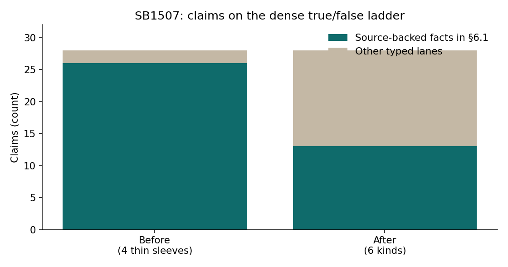
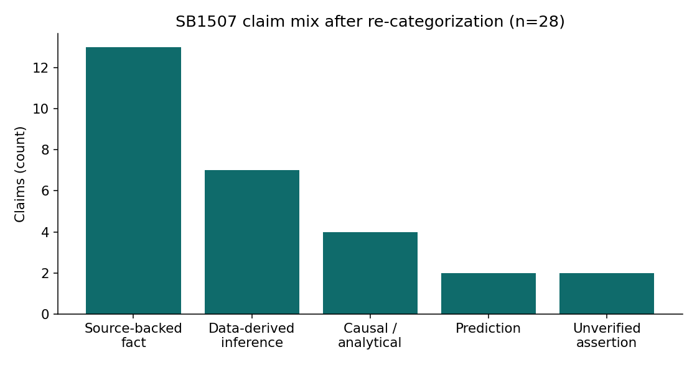

# Part 4 — Two videos: old ladder and new lanes

**Series:** VerityNgn OSS  
**Part 4 of 4 · Release demos**

---

One video cannot prove both the classic consumer path and the analyst-genre path. The 3.0.0 candidate uses two fixtures.

## Lipozem — old ladder (public)

| Field | Value |
|-------|-------|
| ID | `tLJC8hkK-ao` |
| URL | https://www.youtube.com/watch?v=tLJC8hkK-ao |
| Command | `verityngn analyze --tier full --deep … -o outputs/release_v3_lipozem` |
| What it shows | Source-backed facts, TRUE/FALSE ladder, **CRAAP** in §9, counter-intel, Deep Research (`deep.html`) |
| What it does **not** show | Strong multimodal vision. Treat Lipozem-class VSL as a weak vision demo (media checklist lock). |

**Pass criteria:** claims > 0; genre `consumer_factual`; §9 is CRAAP; `deep.html` present; a clinical “% reduction” style claim stays `source_backed_fact`.

## SB1507 — analyst lanes (Chris; full report gated)

| Field | Value |
|-------|-------|
| Source | Local `sb1507.mp4` (Chris Schuermyer, Oregon QSBS / SB 1507) |
| Command | `verityngn analyze --tier local-full -f sb1507.mp4 -o outputs/release_v3_sb1507` |
| What it shows | Six kinds, risk chips, **SIFT** instead of CRAAP, on-screen $ / method claims in `data_derived_inference` |
| Public until Chris approves | Charts in `docs/blog/series/assets/` and aggregate scorecard counts only. Full HTML/transcript stay private. |

**Offline re-stamp (Sep 23 smoke):** 28 claims → 13 facts, 7 data-derived, 4 causal, 2 prediction, 2 unverified; quant→inference 83.3%; scorecard `all_green`.

**Live `outputs/release_v3_sb1507` (2026-10-03):** 5 claims extracted (under-recall vs smoke). Genre `analyst`, SIFT §9, risk chips present. Density gate (§6.1 ≤ half) fails on n=5; see [`RELEASE_TEST_MATRIX_v3.md`](../../launch/RELEASE_TEST_MATRIX_v3.md).

**Live Lipozem `outputs/release_v3_lipozem`:** 40 claims, all source-backed facts, CRAAP §9, `deep.html` — old ladder **PASS**.

*Figure. Claims on the dense true/false ladder: 26/28 before taxonomy vs 13/28 after (offline re-stamp).*

*Figure. Kind mix after re-categorization.*

## Why not the rest of `test_videos.json`

Several rows still point at `dQw4w9WgXcQ`. John Oliver and deposition ids are FAIL for marketing posts. Odd Lots (`tSdWpsj1Cyo`) is an optional third if these two leave a gap — not a release blocker.

## Marketing use

| Asset | Public? |
|-------|---------|
| Lipozem gallery / report link | Yes |
| Density / kind-mix charts | Yes |
| Classification diagram | Yes |
| Full SB1507 analyst HTML | Only with Chris approval |

---

*Previous: [Part 3 — Where the release stands](03-where-the-release-stands.md)*
