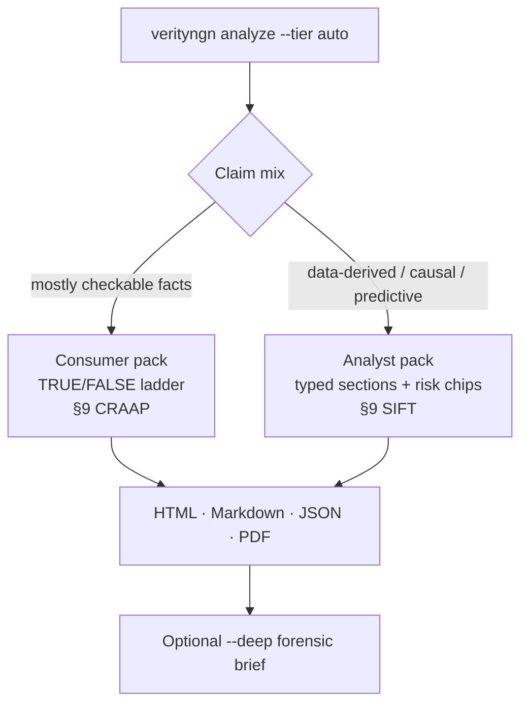
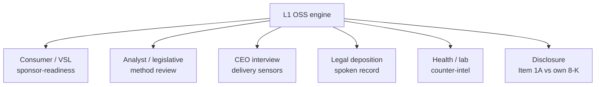
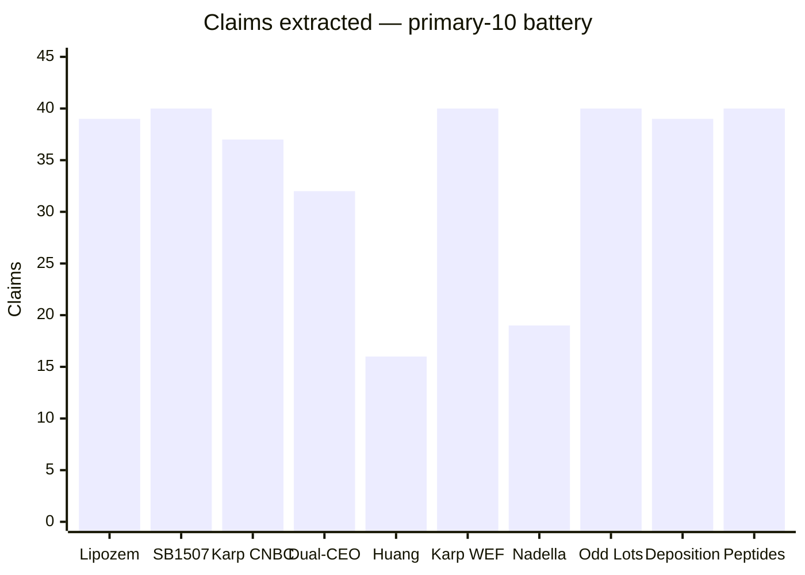
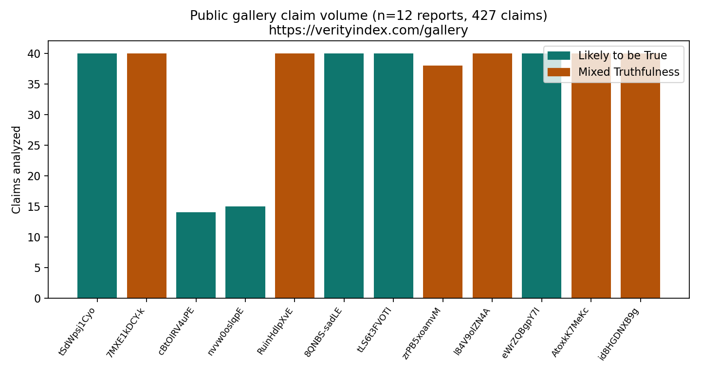
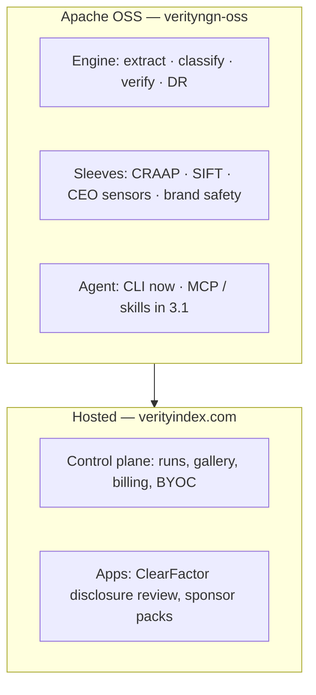
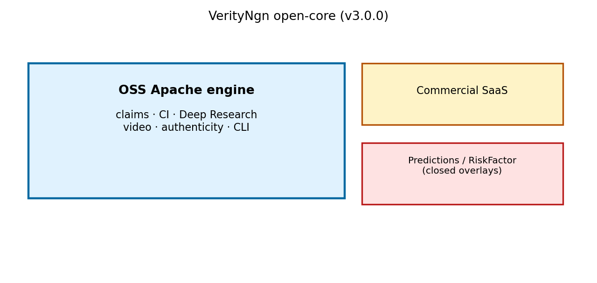

# VerityNgn 3.0: an open claim-risk engine you can run on a video

**Release:** OSS 3.0.0 · Apache-2.0 · branch `release/v3.0.0`  
**CTA:** [GitHub](https://github.com/hotchilianalytics/verityngn-oss/tree/release/v3.0.0) · [gallery](https://verityindex.com/gallery) · `pip install -e '.[deep]'` from the branch until PyPI is cut

Take a YouTube URL or a local file. Get a claim-level **risk** report: what was said, what the pixels showed, what independent sources contradict, and what residual risk remains if someone acts on it.

That is v3.0.0. It is not a lie detector, not an earnings model, and not a crawl of the open web. It is a multimodal engine — extract, classify, verify, report — and the open core of a small risk platform.

---

## The job

Transcript-only checkers miss on-screen graphics. Naive web search often retrieves the subject’s own press as “evidence.” A single TRUE/FALSE ladder mashes a Senate vote together with a modeled forecast and a “in my view.”

VerityNgn 3.0 splits those problems:

1. **See the video**, not just the captions.
2. **Type the claim** (fact, inference, causal argument, opinion, prediction, thin assertion).
3. **Look for contradiction** on purpose — counter-intelligence, not confirmation.
4. **Hand a reviewer an action**, not a moral score.


---

## Features and benefits

| Feature | What it is | Benefit |
|---------|------------|---------|
| **Multimodal extract** | Speech, on-screen text, charts, and exhibits — not transcript-only | You catch claims that live on a slide or a supers, not only in the VO |
| **Six claim kinds** | Fact, data-derived inference, causal/analytical, reasoned opinion, prediction, unverified assertion | A forecast is not “false because it hasn’t happened”; an opinion is not scored as a fact |
| **Counter-intelligence** | Actively search for contradictory reviews; down-weight press-release-shaped sources | You do not treat the subject’s own PR as independent confirmation |
| **Genre-aware §9** | Consumer videos → CRAAP. Analyst videos → SIFT + risk chips | The method review matches the genre instead of forcing one rubric |
| **Analysis tiers** | `light` / `full` / `local-light` / `local-full` | Triage in minutes, or a full diligence pass, without a second product |
| **Deep Research (`--deep`)** | Grounded forensic brief over the claim binder, in the Apache tree | A second model stresses cites without a closed “pro” fork of quality |
| **Captions CLI** | `verityngn captions <url>` | Operators can see whether VTT actually arrived (YouTube Data API metadata is not a caption download) |
| **Open-core engine** | Apache-2.0 CLI + optional `verityngn[predictions]` sensors | Research quality lives in OSS; hosted credits and apps sit on verityindex.com |


*Figure. Six claim kinds. Source-backed facts stay on a true/false ladder. Everything else carries likelihood, evidence confidence, and residual reliance risk — not one mashed score.*

---

## How a run is routed



| Tier | Command | When to use |
|------|---------|-------------|
| **light** | `verityngn analyze --tier light <url>` | Fast YouTube triage |
| **full** | `verityngn analyze --tier full <url> --deep` | Diligence / gallery |
| **local-light** | `verityngn analyze --tier local-light -f clip.mp4` | File transcript → short brief |
| **local-full** | `verityngn analyze --tier local-full -f clip.mp4` | Matter upload, full report |

Consumer example: Lipozem (`tLJC8hkK-ao`) stays on the classic ladder with CRAAP and a Deep Research pass.

Analyst example: a legislative / quantitative video routes into typed sections. Section 9 becomes Stop / Investigate / Find better coverage / Trace — SIFT — instead of CRAAP.

---

## Applications

Same engine. Different **domain packs**: inputs, claim typology, §9 method, and the action you hand a human.



| Application | Who | What v3.0.0 gives them | Proven on |
|-------------|-----|------------------------|-----------|
| **Sponsor-readiness** | Agencies, brands | Claim-level review of a promotional video before money attaches | Lipozem, 39 claims, CRAAP |
| **Analyst method review** | Creators who sell analysis | Typed claims + SIFT so a modeled number is not treated as a news fact | SB1507 local, 40 claims |
| **CEO interview risk** | IR, boards, journalists | What was said on camera, timestamped, against the public record | Karp / Huang / Nadella battery |
| **Deposition / legal spoken** | Counsel, experts | Structured claims from testimony, not a transcript dump | Butler Kahn, 39 claims |
| **Health counter-intel** | Reviewers of contested lab / peptide claims | Contradictory sources sought on purpose | Carney Peptides, 40 claims |
| **Disclosure (paid app)** | GC / disclosure committee | Hedged Item 1A next to the company’s own dated admission | ClearFactor / rfkit sleeve — not the default Batch image |

Hosted gallery and credits live on [verityindex.com](https://verityindex.com). The engine quality path is the same Apache tree.

---

## Proof: primary-10 battery

Ten videos. Every row extracted claims. One documented swap (Huang Squawk replaced a 12-hour LIVE restream that died mid-job). Not a leaderboard. A coverage matrix.





| Lane | Videos | Claims (this battery) |
|------|--------|------------------------|
| Consumer / health | Lipozem, Carney | 39 + 40 |
| Analyst | SB1507 | 40 |
| CEO interview | Karp ×3, Huang, Nadella | 37 + 32 + 16 + 40 + 19 |
| Finance podcast | Odd Lots | 40 |
| Legal spoken | Butler Kahn | 39 |
| **Live rows 3–10** | | **263** |

Full table: [BATTERY_RESULTS_v3.md](BATTERY_RESULTS_v3.md).

---

## Open core, not a closed quality fork





If verification, Deep Research, or the claim typology lived only behind a paywall, the open-core story would be a lie. Those stay in OSS. What you pay for is hosted scale, credits, a gallery, and counsel-side services (vault, engagement, calendar) — not a better engine.

Two names that must not be mashed together:

1. **Predictions / CEO sensors (S00–S15)** — optional OSS extra `verityngn[predictions]`. Delivery / instrument measurement. Not allocation alpha.
2. **ClearFactor disclosure review** — Item 1A hedge vs the company’s own 8-K. Paid app on the same claim/evidence pattern.

---

## Try it

From `release/v3.0.0` until the tag and PyPI move (those clicks stay gated on an explicit operator ask):

```bash
pip install -e '.[deep]'
verityngn analyze --tier light 'https://www.youtube.com/watch?v=tLJC8hkK-ao'
verityngn analyze --tier full 'https://www.youtube.com/watch?v=VIDEO_ID' --deep
verityngn captions 'https://www.youtube.com/watch?v=VIDEO_ID'
```

Gemini / Vertex credentials are required for the LLM path. `VERTEX_LOCATION=global` for current Vertex models. Cookies for yt-dlp when YouTube blocks anonymous caption fetch.

Public gallery: [verityindex.com/gallery](https://verityindex.com/gallery).

---

## What we do not claim

- Not a lie detector and not a single “truthfulness” score.
- Not earnings prediction or portfolio alpha.
- Not an open-web, podcast, or social crawler.
- English-first. YouTube + local file; not TikTok-native.
- LLM-assisted briefs still need a human. If a report looks wrong, the video id is the bug report.

---

## Read next

- Platform layers: [PLATFORM_OVERVIEW.md](../platform/PLATFORM_OVERVIEW.md)
- Domain packs: [DOMAIN_PACKS.md](../platform/DOMAIN_PACKS.md)
- Open-core boundary: [OPEN_CORE.md](../OPEN_CORE.md)
- Series: [docs/blog/series/](../blog/series/README.md) (history → features → battery → platform morph)
- Release notes: [RELEASE_NOTES_v3.0.0.md](RELEASE_NOTES_v3.0.0.md)
