# Multimodal Risk Now (v3.0.1) → Futures (v3.1 / v3.2)

**Audience:** NotebookLM, slides, blogs, exec readers  
**Package lock:** `verityngn==3.0.1` on PyPI (`3.0.0` yanked) · Launch **Monday, Nov 23, 2026**  
**Branch:** `release/v3.0.0` · Engine tip `1b2cca8` · Docs tip `f6aeb2e` (tag `v3.0.1`)  
**Rule:** Separate (a) default-on in 3.0.1, (b) opt-in sleeves already in the wheel, (c) research turning default-on in 3.1 / 3.2 — so no slide contradicts CLI behavior.

---

## 1. Accurate v3.0.1 multimodal pitch & proof numbers

### Default-on today (no extras required)

| Capability | What ships |
|------------|------------|
| Adaptive **1–6 fps** sampling | `lecture_vsl` 1.0 → `montage_motion` 3.0 → HIGH `exhibit_slide` 4.0 → HIGH `flash_ocr` 6.0; `--tier auto` escalates via `visual_text_density` |
| Pixel claim modalities | `visual_text`, `graphic`, `chart`, `demonstration` |
| Brand-safety sidecar | `brand_safety_scores.json` — `visual_only_high_risk_count`, credential-flash events, sub-1000ms disclosure blink risk |
| Exhibit ledger | `{video_id}_exhibit_map.json` — timestamped OCR / Bates / `source_type` |
| Deep Research | `--deep` leads with `visual_only_claims` |

### Empirical proof (v3 release outputs on disk)

| Seed | Pixel-only claims (approx.) | Why it matters |
|------|-----------------------------|----------------|
| **SB1507** legislative | **18 / 40 (45%)** from slides/charts/tables | Transcript-only would miss nearly half the binder |
| Lipozem `tLJC8hkK-ao` | **5** silent testimonial / doctor-authority cards | Credential supers never spoken |
| Peptides `RuinHdlpXvE` | **13** | Contested health visuals |
| Butler Kahn `7MXE1kDCY-k` | **12** | Deposition exhibit OCR |
| CES keynote `fuq0Ncdsknk` | **12** | Spec slides — this live restream was swapped out of the final battery (Vertex 500 after segment 1), so it counts toward 81 but not 69 |
| CNBC `ijRuuaaM6XM` | **10** | Market boards |
| **Final primary-10 total** | **69** (81 minus the swapped-out CES restream's 12) | Scope used in release copy: 342 claims, 69 pixel-only |
| **All-runs total (10 runs)** | **81** (`visual_text` 43 · `graphic` 23 · `chart` 11 · `demonstration` 4) | |
| T-ABL-006 | 67%–74% unique multimodal share on slide/exhibit seeds | Ablation archive |

### Opt-in sleeves already in the 3.0.1 wheel (non-default — see full brief)

These are **sophisticated media paths that ship in the package but do not run on a plain `verityngn analyze`**. Full operator guide: [`OPTIN_MEDIA_PATHS_v3.md`](OPTIN_MEDIA_PATHS_v3.md) · NotebookLM index: [`NOTEBOOKLM_PACK.md`](NOTEBOOKLM_PACK.md).

```bash
pip install 'verityngn[vision,audio,predictions]==3.0.1'
# MULTISENSE_ENABLED=1  ·  VN_AGENTIC_VIDEO=1  ·  AuthenticityGate (fail-closed)  ·  --story-arc
```

| Path | Extra / flag | What you get | Futures destination |
|------|--------------|--------------|---------------------|
| Vision landmarks | `[vision]` · `--story-arc` | MediaPipe 478 landmarks, 52 blendshapes, HFAsy_proxy, continuity JSON | **3.2** pose/lip/face congruence |
| Audio affect | `[audio]` | Librosa prosody, VAD, TTS/synthetic cues | **3.2** audio congruence |
| MultiSense | `[predictions]` · `MULTISENSE_ENABLED=1` | S00–S15 Tier A/B, `_multisense.json`, `_fused_index.json` | **3.2** delivery/conviction track |
| AGENTIC search | `VN_AGENTIC_VIDEO=1` | Gemini `mediaProcessing=AGENTIC` frame search | **3.1** object/action semantics |
| AuthenticityGate | adapters / S00 | Fail-closed C2PA / CorSound / rPPG provenance | stays fail-closed |

**Do not say** these ran on every gallery report. **Do say** they are available today for research operators and are the measurement spine for 3.1/3.2.

---

## 2. Why early prompts caught slides/OCR (77/81) more than physical demos (4/81)

Extraction prompts in analysis still **bias toward OCR, charts, and on-screen text** and under-weight non-text visuals. That is why `visual_text` + `graphic` + `chart` dominate the 81-count, while only **4** claims are typed `demonstration` (product demos, before/after lighting, timelapse motion, crowd/venue framing).

**Honest boundary for Monday launch:** pitch the pixel/OCR/exhibit/brand-safety wins as live; pitch object/action semantics as **3.1 research turning default-on**, not as already proven at scale in 3.0.1.

---

## 3. How old research merges with new multimodal risk research

### Foundational (“old”) threads being unified

| Thread | Sensor / schema | Use |
|--------|-----------------|-----|
| Spot Runner emotional-arc indexing | `sr_*` Plutchik leaves | Story-arc continuity |
| Speech Craft / Mayew & Venkatachalam (2012) | `S05` vocal Q&A reactivity | Delivery scrutiny |
| Qin & Yang (2019) pace/pitch escalation | `S08` | Conviction / stress cues |
| Banker et al. (*Mgmt Sci* 2024) HFAsy | `HFAsy_proxy` `S12` | Hemifacial asymmetry proxy |
| Blankespoor expression–news incongruence | `S13` | Cross-channel mismatch |
| Oxford-Man cross-modal distance | `S01` | Pose/audio distance |
| Krykoniuk et al. (*Nature HSS Comms* 2026) | `S11` Q&A derailment | Discourse risk |
| Kim / Muhn / Nikolaev disclosure | `S15` → ClearFactor / rfkit | Filing vs spoken risk |

### Negative-result hygiene (do not abandon)

From `docs/predictions/VIDEO_CUE_CRITICAL_RATING.md`:

- Refuse near-chance vocal dissonance (`S14`)
- Ban synthetic `0.5` vision fills that leak `n_claims`
- Require within-speaker longitudinal baselines (`SpeakerBaseline`)
- EU AI Act Art. 5(1)(f) non-employment guardrails
- Fail-closed provenance (`S00`) before behavioral scoring

**Framing forever:** reliance, delivery, and disclosure risk — **never** lie detection.

### New research turning default-on in 3.1 / 3.2

1. **Object, prop, and action semantics** (1–6 fps + AGENTIC frame search) — product demos, before/after posture/lighting, sped-up/timelapse, crowd/venue claims.
2. **Visual–spoken contradiction & temporal splice risk** — fine-print supers, chart axes, or jump-cuts that contradict spoken assurances mid-claim.
3. **Default-on pose / lip / face / audio congruence** — promote MediaPipe + MultiSense + librosa/VAD into a calibrated delivery-and-conviction track (within-speaker z-scores; live Q&A diarization for `S05`/`S11`).

---

## 4. Clean roadmap: 3.0.1 → 3.1 → 3.2

```mermaid
flowchart LR
  subgraph live301 ["Live default in v3.0.1"]
    AdaptiveFPS["Adaptive 1–6 fps"]
    PixelClaims["Pixel claims · 81 across 10 runs"]
    BrandSafety["brand_safety_scores.json"]
    ExhibitMap["exhibit_map.json"]
  end
  subgraph optin301 ["In wheel · opt-in"]
    MediaPipe["MediaPipe · blendshapes"]
    AffectAudio["Librosa · VAD · TTS cues"]
    MultiSense["MultiSense S00–S15"]
    AuthGate["AuthenticityGate"]
  end
  subgraph next ["Default-on roadmap"]
    ObjSemantics["3.1 Object / action semantics"]
    VisContra["3.1 Visual–spoken contradiction"]
    CrossModal["3.2 Pose / lip / audio congruence"]
  end
  live301 --> optin301 --> next
```



| Stage | Status | Pitch line |
|-------|--------|------------|
| **3.0.1** | Live on PyPI | “45% of SB1507 claims and Lipozem’s doctor/weight-loss cards exist only in pixels; adaptive 1–6 fps + brand-safety/exhibit JSONs ship default-on.” |
| **3.1** | Roadmap | Object/action semantics + visual–spoken contradiction + splice risk. |
| **3.2** | Roadmap | Pose/lip/face/audio congruence default-on atop sleeves already in the wheel. |

### Install lock (do not recommend 3.0.0)

```bash
pip install 'verityngn[deep]==3.0.1'
# optional: pip install 'verityngn[vision,audio,predictions]==3.0.1'
```

---

## Related collateral

- NotebookLM upload guide: [`NOTEBOOKLM_PACK.md`](NOTEBOOKLM_PACK.md)
- Opt-in sophisticated paths (full): [`OPTIN_MEDIA_PATHS_v3.md`](OPTIN_MEDIA_PATHS_v3.md)
- Release paper §2 + §8: `papers/verityngn_oss_v3_release.md`
- Ablation T-ABL-006 forward note: `papers/verityngn_v3_ablation_archive.md`
- Blog post multimodal + futures: `BLOG_POST.md` (this pack)
- Root README “What's in v3.0.1” + roadmap
- Deck slide **12D** (Multimodal Now → Futures)
