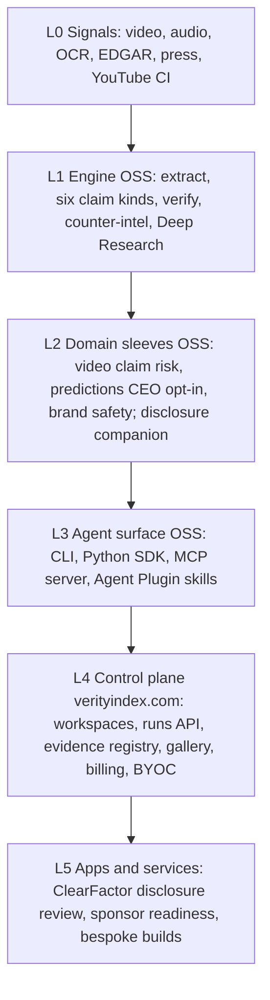

# VerityNgn platform overview — 3.0.1

**Branch / tag:** `release/v3.0.0` · PyPI `verityngn==3.0.1` (`3.0.0` yanked) · Launch: **Monday Nov 23, 2026** · Examples: [`docs/launch/EXAMPLES.md`](../launch/EXAMPLES.md) · Multimodal brief: [`docs/launch/v3_release_pack/MULTIMODAL_AND_FUTURES_v3.md`](../launch/v3_release_pack/MULTIMODAL_AND_FUTURES_v3.md)  
**Framing:** claim-level **risk abatement** platform — not a lie detector, not earnings alpha.

VerityNgn started as a YouTube → truthfulness report pipeline. **v3.0.1** ships that pipeline as the durable **engine** of a layered platform: open domain sleeves (including default-on pixel risk + brand-safety / exhibit sidecars), an agent surface, a hosted control plane on [verityindex.com](https://verityindex.com), and paid apps/services (ClearFactor disclosure review first).

## Layer stack

| Layer | What it is | Live in 3.0.1 | License / home |
|-------|------------|---------------|----------------|
| **L0 Signals** | Multimodal video (adaptive 1–6 fps), captions, OCR/exhibits, EDGAR, press, YouTube CI | Default-on | Inputs to OSS |
| **L1 Engine** | Extract → six claim kinds → pixel modalities → verify → CI → Deep Research + `visual_only_claims` | Default-on | Apache-2.0 `verityngn-oss` / PyPI `3.0.1` |
| **L2 Sleeves** | Domain packs (CRAAP, SIFT, legal, health, brand) + MediaPipe / MultiSense / audio extras; disclosure via rfkit companion | Video packs default-on; vision/audio/predictions **opt-in** → default-on in **3.1/3.2**; `verityngn[disclosure]` empty in 3.0.1 | Apache extras + companion |
| **L3 Agent** | CLI, Python SDK; MCP + Agent Plugin in 3.1.0 | CLI/SDK now; MCP 3.1 | Apache-2.0 |
| **L4 Control plane** | Workspaces, runs API, gallery, billing, BYOC | Hosted | verityindex.com |
| **L5 Apps / services** | ClearFactor counsel briefs, vault, quarterly monitor, bespoke | Paid | Commercial |

## Morph: report → platform

| Then (report product) | Now (platform) |
|-----------------------|----------------|
| One HTML/PDF truthfulness report | Same artifacts as **evidence objects** in a registry |
| Single consumer CRAAP path | **Domain packs** with genre-aware §9 (CRAAP vs SIFT) |
| CLI-only | CLI + hosted runs + (3.1) MCP / skills |
| “Is it true?” | “What claim-level risk remains, and what action?” |
| Predictions/RiskFactor closed | **Two RiskFactor names** — see below |

## Two products named RiskFactor

Do not conflate:

1. **Predictions / RiskFactor sensors (S00–S15)** — CEO video delivery / instrument risk measurement, already in OSS (`verityngn[predictions]`). See [docs/predictions/](../predictions/).
2. **ClearFactor / rfkit disclosure RiskFactor** — Item 1A hedge vs own 8-K / incident log; counsel brief (Rewrite / Keep / Move / Remove). **Companion** (not in the `verityngn==3.0.1` wheel); vault + engagements stay paid. See [COMMERCIAL_MAP.md](COMMERCIAL_MAP.md).

## External schema we map onto

| Pattern | Analog for VerityNgn |
|---------|----------------------|
| LangChain OSS → LangSmith control plane | L1–L3 OSS → L4 verityindex.com |
| Credo / Holistic “policy packs” | Domain packs ([DOMAIN_PACKS.md](DOMAIN_PACKS.md)) |
| Agent Plugins / MCP marketplaces | 3.1.0 agent surface |
| Glimmer “decision infrastructure” | L5 action labels, not more crawl |

Landscape notes: [PLATFORM_LANDSCAPE_2026.md](PLATFORM_LANDSCAPE_2026.md).

## What we do not build

- Crawl / scrape / surveil (Derrick context-stack steps 1–2)
- Allocation alpha or Family B trading products in OSS
- Lie-detector or single moral “truth score” marketing

## Related

- [OPEN_CORE.md](../OPEN_CORE.md) · [DEPENDENCY_MODEL.md](../DEPENDENCY_MODEL.md)
- [BATTERY_RESULTS_v3.md](../launch/BATTERY_RESULTS_v3.md) · [RELEASE_TEST_MATRIX_v3.md](../launch/RELEASE_TEST_MATRIX_v3.md)
- Figure: `papers/figures/platform_layers.png`
