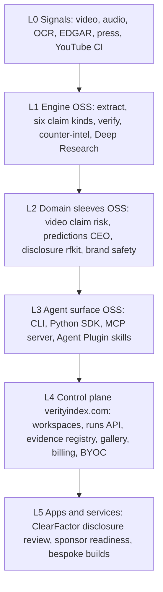

# VerityNgn platform overview — 3.0.0

**Branch:** `release/v3.0.0` · **Candidate SHA:** `b13bcf1`  
**Framing:** claim-level **risk abatement** platform — not a lie detector, not earnings alpha.

VerityNgn started as a YouTube → truthfulness report pipeline. v3.0.0 ships that pipeline as the durable **engine** of a layered platform: open domain sleeves, an agent surface, a hosted control plane on [verityindex.com](https://verityindex.com), and paid apps/services (ClearFactor disclosure review first).

## Layer stack

| Layer | What it is | License / home |
|-------|------------|----------------|
| **L0 Signals** | Multimodal video, captions, EDGAR filings, press, YouTube counter-intel | Inputs to OSS |
| **L1 Engine** | Extract → six claim kinds → verify → CI → Deep Research | Apache-2.0 `verityngn-oss` |
| **L2 Sleeves** | Domain packs (CRAAP, SIFT, disclosure, legal, health, brand) | Apache extras / companion OSS |
| **L3 Agent** | CLI, Python SDK; MCP + Agent Plugin in 3.1.0 | Apache-2.0 |
| **L4 Control plane** | Workspaces, runs API, gallery, billing, BYOC | Hosted on verityindex.com |
| **L5 Apps / services** | ClearFactor counsel briefs, vault, quarterly monitor, bespoke | Paid |

## Morph: report → platform

| Then (report product) | Now (platform) |
|-----------------------|----------------|
| One HTML/PDF truthfulness report | Same artifacts as **evidence objects** in a registry |
| Single consumer CRAAP path | **Domain packs** with genre-aware §9 (CRAAP vs SIFT) |
| CLI-only | CLI + hosted runs + (3.1) MCP / skills |
| “Is it true?” | “What claim-level risk remains, and what action?” |
| Predictions/RiskFactor closed | **Two RiskFactor names** — see below |

## Two products named RiskFactor

Do not conflate:

1. **Predictions / RiskFactor sensors (S00–S15)** — CEO video delivery / instrument risk measurement, already in OSS (`verityngn[predictions]`). See [docs/predictions/](../predictions/).
2. **ClearFactor / rfkit disclosure RiskFactor** — Item 1A hedge vs own 8-K / incident log; counsel brief (Rewrite / Keep / Move / Remove). Engine path: open as Apache sleeve; vault + engagements stay paid. See [COMMERCIAL_MAP.md](COMMERCIAL_MAP.md).

## External schema we map onto

| Pattern | Analog for VerityNgn |
|---------|----------------------|
| LangChain OSS → LangSmith control plane | L1–L3 OSS → L4 verityindex.com |
| Credo / Holistic “policy packs” | Domain packs ([DOMAIN_PACKS.md](DOMAIN_PACKS.md)) |
| Agent Plugins / MCP marketplaces | 3.1.0 agent surface |
| Glimmer “decision infrastructure” | L5 action labels, not more crawl |

Landscape notes: [PLATFORM_LANDSCAPE_2026.md](PLATFORM_LANDSCAPE_2026.md).

## What we do not build

- Crawl / scrape / surveil (Derrick context-stack steps 1–2)
- Allocation alpha or Family B trading products in OSS
- Lie-detector or single moral “truth score” marketing

## Related

- [OPEN_CORE.md](../OPEN_CORE.md) · [DEPENDENCY_MODEL.md](../DEPENDENCY_MODEL.md)
- [BATTERY_RESULTS_v3.md](../launch/BATTERY_RESULTS_v3.md) · [RELEASE_TEST_MATRIX_v3.md](../launch/RELEASE_TEST_MATRIX_v3.md)
- Figure: `papers/figures/platform_layers.png`
