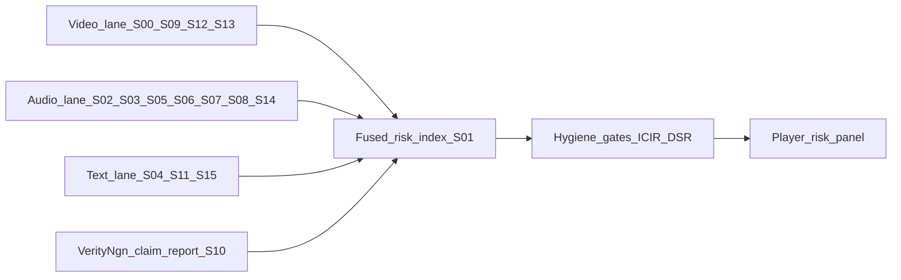

# Risk-factor registry S00–S15

**Date:** 2026-08-14  
**Player scope:** Longitudinal *within* player (never cross-CEO norms until calibrated).  
**Language:** Congruence / delivery-risk / disclosure-risk — **not** a lie detector, clinical diagnosis, or employment screen (EU AI Act Art. 5(1)(f)).  
**Promote:** Every row inherits **NO_PROMOTE** until hygiene gates in `docs/trials_ledger.md` pass.

S01–S11 are implemented (Karp corpus). S00 and S12–S15 are **specified here** for buildout; status column marks the gap.

---

## Bucket map

| Bucket | Factors |
|--------|---------|
| Video | S00, S09, S12, S13 |
| Audio | S02, S03, S05, S06, S07, S08, S14 |
| Text | S04, S11, S15 |
| VerityNgn report | S10 |
| Fused | S01 |

---

## Full registry

| ID | Name | Bucket | Risk name | What it measures | Method / code | Status | Primary citation |
|----|------|--------|-----------|------------------|---------------|--------|------------------|
| **S00** | Media provenance integrity | Video | **Source-integrity risk** | Deepfake / voice-clone / provenance gate before any factor | `authenticity/adapters/corsound.py` (design); authenticity sleeve in PREDICTIONS_DESIGN | Spec — gate exists, unnumbered until now | Design doc authenticity gate; Corsound-class voice authenticity |
| **S01** | Cross-channel congruence | Fused | **Delivery-consistency risk** | Text / voice / face agreement at claim time; high = channels agree (**not** truth) | `fusion/crossmodal.py` · `build_karp_signal_report.py` | **Live** (n=7 Karp) | Internal fusion; Oxford-Man modal incongruence draft 2026 |
| **S02** | Interpreted vs measured agreement | Audio+video | **Instrument risk** | Gemini interpreted affect vs microphone/prosody | `fusion/gemini_multisense.py` + `affect/extract.py` | **Live** — often `prosody_proxy` / valence_gap | Multisense calibration scripts |
| **S03** | Emotional arc volatility | Audio | **Composure variability** | Arousal stdev across Tier A segments | Tier A segments in multisense | **Live** | Plutchik arcs; interview vs prepared venue prior |
| **S04** | Topic-affect fingerprint | Text+audio | **Topic-exposure risk** | Dominant emotion on geopolitics- vs business-tagged windows | Keyword + OCR/claim tags in report builder | **Live** | Internal; topic tags heuristic |
| **S05** | Q&A reactivity delta | Audio | **Scrutiny-response risk** | Answer arousal − question arousal | Tier A speaker labels + Q/A split | **Live** (often null this rollup) | Mayew & Venkatachalam, *The Power of Voice*, **J. Finance 67(1) 2012** |
| **S06** | Exuberance z per claim | Audio | **Emphasis concentration** | Claim energy vs that video’s mean | `affect/exuberance.py` | **Live** | Within-video z only until n≥5 |
| **S07** | Disfluency rate | Audio | **Fluency risk** | Filled pauses / restarts | Claim-text regex today; ASR target | **Live** (floor until ASR) | Affect disfluency module |
| **S08** | Pace / pitch escalation | Audio | **Escalation risk** | High pitch-variability share + pace transitions | Gemini delivery bands + prosody | **Live** | Qin & Yang 2019, ACL (*What You Say and How You Say It Matters*) |
| **S09** | Facial–vocal–verbal alignment | Video | **Clip incongruence risk** | Tier B clip congruence (prose face, not FACS) | `gemini_multisense` Tier B | **Live** | Observational only |
| **S10** | Conviction–claim coupling | Report | **Claim-conviction mismatch** | Categorical verdict × delivery-risk band | Claims report + crossmodal band | **Live** | VerityNgn verification engine |
| **S11** | Discourse derailment | Text | **Responsiveness / topic-shift risk** | Distance: LLM expected on-topic answers vs actual | `fusion/derailment.py` | **Live** (null when no Q/A pairs) | Krykoniuk, Hopkin-King & Roberts 2026, *Humanit Soc Sci Commun* [s41599-026-07900-x](https://www.nature.com/articles/s41599-026-07900-x) |
| **S12** | Dynamic hemifacial asymmetry (HFAsy) | Video | **Perceived-credibility risk** | Left/right face emotion asymmetry over interview | Roadmap: `vision/action_units.py`, py-feat / OpenFace | **Spec** | Banker et al., **Management Science 70(7) 2024**, [10.1287/mnsc.2023.4922](https://doi.org/10.1287/mnsc.2023.4922) — 205 CNBC CEO videos; neg CAR, wider spreads. Also Dai/Huang/Li SSRN 4720163 (audit fees) |
| **S13** | Expression–news incongruence | Video × fundamentals | **Analyst-disagreement risk** | Facial valence contradicts earnings news sign | Needs earnings surprise join + face valence | **Spec** | Blankespoor, Ji, Ng & Zhao, SSRN [4598747](https://papers.ssrn.com/sol3/papers.cfm?abstract_id=4598747) |
| **S14** | Vocal dissonance marker | Audio | **Restatement / misreporting risk** (research-only) | Vocal cognitive-dissonance markers | Vendor LVA optional (`deception/adapters/nemesysco.py`); measured path preferred | **Spec — caveat mandatory** | Hobson, Mayew & Venkatachalam, *Analyzing Speech to Detect Financial Misreporting* — accuracy only ~8–17% above chance; LVA deception classifier ≈ chance (Eriksson & Lacerda). **Ship caveat or do not ship.** |
| **S15** | Disclosure risk exposure | Text | **Disclosure / governance risk** | LLM-derived political / climate / AI risk from transcripts or filings | New text sleeve; GC quarterly-pack path | **Spec** | Kim, Muhn & Nikolaev, *From Transcripts to Insights*, BFI WP 2023-132 · [arXiv:2310.17721](https://arxiv.org/abs/2310.17721) |

---

## Roadmap sensors that feed new video rows

Already stubbed in the predictions worktree:

| Sensor | Path | Feeds |
|--------|------|-------|
| Gaze / blink / head pose | `verityngn/services/vision/gaze_blink.py` | S09 enrichment; future S12 aux |
| FACS action units | `vision/action_units.py`, adapters `pyfeat.py` / `openface3.py` | S12, S13 (replace prose face) |
| audEERING VAD | `affect/adapters/audeering_vad.py` | S02 (kill `prosody_proxy`) |
| Whissle visual lane | arXiv:2606.22699 | Gaze/blink/pose research track |
| Multimodal AU + voice | arXiv:2407.06005 | S09 / S12 fusion |

---

## Heuristic bands (not calibrated)

Carry forward from Karp vocab until n supports player-lifetime z:

| Quantity | Low / floor | Moderate | High / elevated |
|----------|-------------|----------|-----------------|
| S01 congruence | < 0.55 | 0.55–0.75 | ≥ 0.75 |
| S03 arousal pstdev | < 0.18 | — | ≥ 0.18 |
| S05 Q&A Δ | < 0.25 flat | — | ≥ 0.25 reactive |
| S11 derailment | < 0.25 on-topic | 0.25–0.45 | ≥ 0.45 topic shift |
| S02 | `aligned` if min valence agreement ≥ 0.55 | — | `valence_gap` otherwise |

S12–S15 bands: **TBD** — register a trial before peeking any CAR / volatility association.

---

## Implementation order

1. Keep S01–S11 rolling on Karp; fix CAR join (T010).  
2. Number authenticity gate as **S00** in report builder.  
3. Prototype **S12** on CNBC videos with py-feat (Banker-style).  
4. Prototype **S13** once surprise + face valence exist.  
5. **S15** text risk on transcripts / 10-K risk sections (Horner GC sleeve).  
6. **S14** only behind research flag + published near-chance caveat.

---

## What we do **not** claim

- Deception, “tells,” hidden intent, or that derailment / dissonance = lying  
- Cross-speaker ranking before calibrated norms  
- Employment / education / insurance fitness  
- That `prosody_proxy` valence is ground-truth affect  
- That any SXX is a tradable factor while **NO_PROMOTE**
