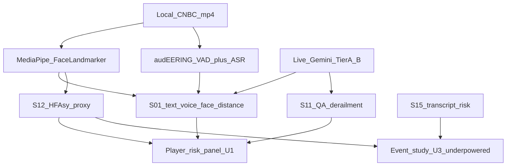

# Video cue critical rating (S00–S15 + arcs)

**Date:** 2026-08-20  
**Grades:** **PASS** / **WEAK** / **FAIL** on three axes — (i) computable now, (ii) risk-abatement usefulness at small n, (iii) eventual event-study usefulness.  
**Language:** Congruence / delivery-risk / disclosure-risk. Not a lie detector. Oxford-Man *distance* method is in-scope; deception framing is not.

Companion: [GATES_GLOSSARY.md](GATES_GLOSSARY.md), [RISK_FACTOR_REGISTRY_S00_S15.md](RISK_FACTOR_REGISTRY_S00_S15.md), [USEFULNESS_RUNGS.md](USEFULNESS_RUNGS.md).

---

## Executive verdict

| Lane | Now | Call |
|------|-----|------|
| Measured audio (VAD + ASR + prosody) | 7/7 Karp | **PASS** — only honest measured lane; keep |
| Live Gemini Tier A/B | 1/7 | **WEAK** — cheapest Fidelity jump (T017) |
| Measured face | 0/7 | **FAIL** until MediaPipe Face Landmarker (T018) |
| Story arcs / S03 / S04 | Heuristic | **WEAK–FAIL** — UI ok; not a factor |
| S11 / S05 Q&A | Method PASS, corpus FAIL | Need live Gemini speaker-labeled Q/A |
| S14 vocal dissonance | Spec | **Do not ship** (near-chance) |
| S15 text disclosure risk | Spec | **PASS for significance** while video n is small |

Do **not** re-enable synthetic vision into fusion — that recreated the S01↔n_claims leak.

---

## Sensor inventory (implemented vs stub)

| Sensor | Path | Status | Rating |
|--------|------|--------|--------|
| audEERING VAD | `affect/adapters/audeering_vad.py` | Measured on Karp | **PASS** |
| faster-whisper ASR | `affect/asr.py` | Measured on Karp | **PASS** |
| Prosody / exuberance | `affect/prosody.py`, `exuberance.py` | Measured | **PASS** |
| Gemini Tier A/B | `fusion/gemini_multisense.py` | 1/7 live | **WEAK** |
| MediaPipe Face Landmarker | `vision/adapters/mediapipe.py` | Stub → implement T018 | **PASS target** |
| py-feat Detectorv2 | `vision/adapters/pyfeat.py` | Optional real; not in Karp runs | **WEAK** (heavy) |
| OpenFace 3.0 | `vision/adapters/openface3.py` | Stub | Defer (Banker AU-for-AU only) |
| pyVHR / rPPG | `vision/adapters/pyvhr.py`, `spectral.py` | Stub / synthetic | **FAIL** as stress without SympCam |
| Gaze / blink synthetic | `vision/gaze_blink.py` | Hash-seeded | **FAIL** until MediaPipe |
| FACS AU synthetic | `vision/action_units.py` | Hash-seeded | **FAIL** until py-feat/OpenFace |
| Story arcs | `fusion/arcs.py` | Change-point on exuberance | **WEAK** UI |

---

## S00–S15 ratings

| ID | Name | Computable now | Small-n risk use | Event-study | Grade | Notes |
|----|------|----------------|------------------|---------------|-------|-------|
| S00 | Media provenance | Spec | High | Gate only | **WEAK** | Number authenticity gate; keep ahead of factors |
| S01 | Cross-channel congruence | Text×voice only | Medium | High *with face* | **WEAK→PASS** | Renormalize; never 0.5-fill face. Oxford-Man distance once face lands |
| S02 | Interpreted×measured | Live | Medium | Medium | **PASS** | Instrument risk; valence_gap when proxy |
| S03 | Emotional arc volatility | `pstdev(arousal)` | Low | Low | **WEAK** | Venue (CNBC vs WEF) dominates |
| S04 | Topic-affect fingerprint | Keyword + 530s Karp cut | Low | Low | **FAIL** | Demo-only until claim/OCR tags, no clock hack |
| S05 | Q&A reactivity Δ | Unscored (0 pairs) | High *if Q/A* | High | **PASS lit / FAIL corpus** | Mayew & Venkatachalam JF 2012 |
| S06 | Exuberance z | Live | Medium | Medium | **PASS** | Within-video z only |
| S07 | Disfluency rate | Floor until ASR words | Low | Medium | **WEAK** | Claim-text regex weak |
| S08 | Pace / pitch escalation | Live (often calm) | Medium | Medium | **PASS** | Qin & Yang 2019 |
| S09 | Facial–vocal–verbal | Gemini prose / 0.50 | Low | High *with face* | **FAIL** | Placeholder until MediaPipe/py-feat |
| S10 | Conviction–claim coupling | Live | Medium | Low | **PASS** | Report×delivery band |
| S11 | Discourse derailment | Unscored (0 pairs) | High *if Q/A* | Medium | **PASS method / FAIL corpus** | Krykoniuk 2026; never disinfo |
| S12 | HFAsy (hemifacial asym) | Spec → `HFAsy_proxy` | High on CNBC TH | High | **PASS target** | Banker MS 2024; blendshape L/R ≠ full CNN HFAsy |
| S13 | Expression–news incongruence | Spec | Medium | High | **WEAK** | Needs surprise + face valence; Blankespoor SSRN 4598747 |
| S14 | Vocal dissonance | Spec | Research-only | Near-chance | **FAIL ship** | Hobson/Mayew 8–17% above chance; LVA ≈ chance |
| S15 | Disclosure risk (text) | Spec | **High** | **High** | **PASS** | Kim/Muhn/Nikolaev; significant-n sleeve |

---

## Story arcs — harsh rating

| Artifact | What it does | Grade |
|----------|--------------|-------|
| `fusion/arcs.py` | z-threshold splits on 0.6×exuberance + 0.4×sympathetic_arousal | **WEAK** UI / **FAIL** factor (arousal missing → collapses to exuberance) |
| S03 | Tier A arousal pstdev | **WEAK** — too coarse |
| S04 | Geo vs business keyword + `TOPIC_GEO_CUT_SEC = 530` for one video | **FAIL** as factor |
| S11 | Expected vs actual Q&A distance | **PASS** method; need live speaker-labeled pairs |
| S05 | Answer − question arousal | Same Q/A prerequisite |

Narrative cue that earns a 2026 citation: **S11**, not S03/S04.

---

## MediaPipe Face Landmarker (Google OSS)

Docs: [Face Landmarker](https://ai.google.dev/edge/mediapipe/solutions/vision/face_landmarker).

| Item | Detail |
|------|--------|
| API | `mediapipe.tasks.python.vision.FaceLandmarker` (Tasks API) |
| Not | Deprecated `mediapipe.solutions.face_mesh` |
| Outputs | **478** 3D landmarks, **52** ARKit-style blendshapes (explicit L/R), facial transform matrix |
| License | Apache 2.0, on-device |
| Detector stage | BlazeFace short-range (inside landmarker) |

### Use for (T018)

1. Presence + talking-head coverage per claim window  
2. Blink / gaze-from-blendshape / head pose → replace synthetic `gaze_blink`  
3. **`HFAsy_proxy` (S12 on-ramp):** L1 of L vs R blendshapes over time on CNBC talking-heads  
4. Face valence/arousal proxy → restore S01 voice–face and face–text **without 0.5 fill**

### Do not use for

- FACS AUs (blendshapes ≠ OpenFace AUs)  
- Lie / stress / rPPG  
- Multi-person two-shots without speaker crop (`ijRuuaaM6XM` = coverage-fail test)

### Vs py-feat / OpenFace

| Tool | Role | Sequence |
|------|------|----------|
| **MediaPipe** | Cheap measured face + HFAsy_proxy | **First** (T018) |
| **py-feat** | Closer to FACS; existing adapter | Confirm AUs on same 2 CNBC clips later |
| **OpenFace 3.0** | Academic gold standard | Only if AU-for-AU Banker replication |

Fidelity allowlist must include `mediapipe_face_landmarker` (previously only `pyfeat_detectorv2` / `openface3` / `pyvhr`). Unknown tags must not score 1.0 by accident.

Banker et al. (Management Science 70(7) 2024) used **205 CNBC earnings interviews** and a CNN on *mirrored hemifaces* (Ekman-7). Label ours **`HFAsy_proxy`**, not HFAsy — not a 1:1 replication.

---

## Research that moves the needle (ranked)

| Rank | Citation | What we take | What we refuse |
|------|----------|--------------|----------------|
| 1 | Siew et al., Oxford-Man 2026 (2,439 interviews) | Cosine distance text/audio/video = modal incongruence → S01 with face | Deception / “concealing” framing |
| 2 | Banker et al., MS 2024 | CNBC talking-head catalog template + HFAsy → CAR/spreads | Claiming our blendshape L1 is their CNN HFAsy |
| 3 | Blankespoor et al., SSRN 4598747 | Face valence vs earnings-news sign → dispersion (S13) | Shipping before surprise join + measured face |
| 4 | Mayew & Venkatachalam, JF 2012 | S05 vocal affect under scrutiny | — |
| 5 | Qin & Yang 2019 (576 S&P calls) | Audio cold-start for S05/S08 | Using as video substitute |
| 6 | Kim, Muhn, Nikolaev 2023 | S15 disclosure-risk → abnormal vol | — |
| 7 | Krykoniuk et al. 2026 | S11 topic-shift derailment | Disinfo / lie labels |
| 8 | ICIS 2025 / JIS 2026 (Liu–Hu–Vasarhelyi) | Nonverbal (neg face) dominates forward-looking content | More Gemini prose instead of measured face |

**Do not ship:** Hobson/Mayew S14; raw rPPG as stress; Nemesysco / Revealense.

---

## Preferred T018 videos

| Video | Venue | Role |
|-------|-------|------|
| `QNkPpVYagRc` | CNBC Davos 2024 | Talking-head; already live Gemini |
| `WBu9Ai6OX3I` | CNBC Eisen | Talking-head |
| `pHu-FarYZlU` | Squawk Box | Talking-head |
| `ijRuuaaM6XM` | Karp + Huang | **Coverage-fail test** (two-shot) |
