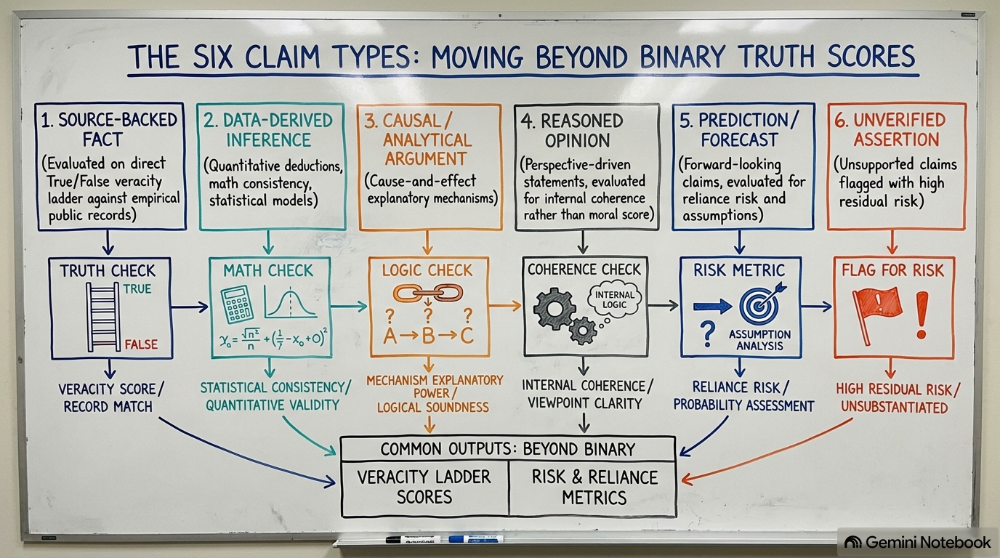

# Verity Engine OSS 3.0.1: An Open Video-to-Text Truthfulness and Risk Engine

Originally published on Substack at [https://ajjcop.substack.com](https://ajjcop.substack.com) · Release: OSS 3.0.1 · Apache-2.0 License · Engine Tip: 1b2cca8 · Package: `pip install 'verityngn[deep]==3.0.1'`

**Detailed technical release (PDF, checked into the repo):** [Verity Engine OSS 3.0.1 — Official Technical Architecture & Release Paper](https://github.com/hotchilianalytics/verityngn-oss/blob/v3.0.1/docs/releases/v3.0.1/verity-engine-oss-3.0.1-golden-release-paper.pdf)

***

## Part I. Whiteboard Front Page: Architectural Briefing

This whiteboard-style front page synthesizes the core pipeline, visual recognition stack, epistemological taxonomy, domain pack expansion, and platform boundaries.

### Whiteboard Architectural Overview

### 1. The Operational Problem: Why Video Truthfulness Requires Multimodal Video-to-Text
Automated fact-checking tools have historically failed when applied to video media because of three fundamental design limitations:
* **Transcript-Only Blindness**: Traditional fact-checkers operate purely on audio speech-to-text. They are completely oblivious to on-screen presentation slides, financial tables, lower-third graphics, scientific diagrams, and silent disclaimer cards flashing across the screen.
* **The Binary Truth Trap**: Standard truth-checkers compress nuanced propositions onto an artificial True/False binary. This collapses empirical facts, complex statistical models, causal arguments, speculative projections, and subjective perspectives into a single moralizing score that analysts cannot defend.
* **Confirmation-Biased Retrieval**: Naive automated search queries search engines using the presenter's exact promotional wording, retrieving the subject's own press releases, affiliate marketing landing pages, and sponsored content as supposed corroboration.

Verity Engine OSS 3.0.1 re-engineers this discipline from first principles. It functions strictly as a video-to-text truthfulness and risk assessment application. It ingests video inputs (YouTube URLs or local MP4 video files), extracts spoken dialogue and visual pixel data in parallel, categorizes claims across a six-kind taxonomy, searches independently for contradictory records, and delivers an audited evidence binder.

### 2. High-Level Ingestion and Verification Flow
The engine executes an automated five-stage verification pipeline:
1. **Multimodal Recognition**: Ingests video frames and audio concurrently via adaptive 1–6 fps content-aware keyframe sampling, multimodal speech understanding (Gemini plus verified YouTube caption tracks, with optional Groq Whisper ASR), and on-screen text and graphic extraction (OCR-style) from the sampled frames.
2. **Claim Isolation and Typing**: Extracts discrete propositions and routes each into one of six epistemological claim kinds.
3. **Counter-Intelligence Retrieval**: Executes targeted adversarial web search queries to surface disconfirming evidence, independent audits, and regulatory enforcement actions while down-weighting promotional press releases and weighting sources by domain reputation.
4. **Genre-Aware Evaluation Routing**: Automatically directs consumer media into the CRAAP framework (Currency, Relevance, Authority, Accuracy, Purpose) and routes analytical or legislative material into the SIFT framework (Stop, Investigate, Find better coverage, Trace).
5. **Grounded Deep Research Synthesis**: Applies a secondary analytical pass that stress-tests every claim against retrieved citations and outputs structured Markdown, HTML, JSON, and PDF dossiers.

### Whiteboard Claim Typology

### 3. The Six-Kind Claim Taxonomy
* **Source-Backed Fact**: Concrete empirical, historical, or physical propositions evaluated directly on an empirical True/False veracity ladder against verified public records.
* **Data-Derived Inference**: Quantitative conclusions, mathematical modeling, and statistical extrapolations evaluated for analytical validity and underlying data consistency.
* **Causal / Analytical Argument**: Explanatory theories linking actions to outcomes, evaluated for logical integrity, mechanism validity, and confounding variables.
* **Reasoned Opinion**: Perspective-driven assertions and philosophical arguments evaluated for internal consistency rather than empirical truth.
* **Prediction / Forecast**: Forward-looking probabilistic projections evaluated for residual reliance risk and baseline assumptions rather than binary truthfulness.
* **Unverified Assertion**: Unsupported propositions lacking verifiable evidence, flagged directly with high residual reliance risk for manual human inspection.

### Whiteboard Domain Expansion

*Note: in this diagram, Pack 6 (Corporate Disclosure) is delivered by the rfkit / ClearFactor companion, not by the `verityngn==3.0.1` wheel.*

### 4. Six Expanded Institutional Domain Packs
Moving beyond early versions that focused solely on consumer supplement advertisements and peptide sales, Verity Engine defines six institutional domain packs: five run in the 3.0.1 engine, and the sixth (disclosure) is a companion:
* **Consumer & VSL Sponsor-Readiness**: Evaluates affiliate marketing and sponsor-readiness under CRAAP rubrics (demonstrated on Lipozem with 39 extracted claims).
* **Legislative, Fiscal & Analyst Method Review**: Evaluates public policy hearings and quantitative briefings under SIFT rubrics (demonstrated on the Oregon SB 1507 legislative scorecard with 40 claims, where 45% of claims were pixel-only visual exhibits).
* **Executive & Leadership Interview Diligence**: Timestamps broadcast executive statements and checks them against public records through counter-intelligence web search.
* **Legal Deposition & Sworn Spoken Testimony**: Structures testimonial statements into verifiable claims without transcript bloat (demonstrated on Butler Kahn legal testimony with 39 claims).
* **Health Sciences & Contested Clinical Research**: Counter-intelligence diligence targeting lab claims and aggressive bio-marketing (demonstrated on Carney Peptides with 40 claims).
* **Corporate Disclosure & Filing Reconciliation** *(companion, not in the 3.0.1 wheel)*: Pairs corporate 10-K Item 1A hedged risk factors against dated factual admissions. This pack ships with the rfkit / ClearFactor disclosure companion; the `verityngn[disclosure]` extra in 3.0.1 is an empty placeholder.

### Whiteboard Open-Core Architecture

### 5. Open-Core Platform Boundaries
* **Apache-2.0 Open-Source Engine**: Houses the complete video-to-text recognition pipeline, adaptive 1–6 fps frame sampling with on-screen text extraction, multimodal speech understanding, six-kind claim typology, counter-evidence graph, SIFT/CRAAP rubrics, local CLI, and Streamlit workspace.
* **Optional Research Sleeves**: Non-default wheels for specialized computer vision landmarks, audio affect analysis, and executive delivery sensors.
* **Commercial Hosted Platform**: Managed cloud orchestration, team collaboration workspaces, persistent public verification galleries, and enterprise compliance services available on [https://verityindex.com](https://verityindex.com).

***
## Part II. Long-Form Release Essay: Engineering Verity Engine OSS 3.0.1

### 1. Defining the Core Mission: A Dedicated Video-to-Text Truthfulness and Risk App
Verity Engine OSS 3.0.1 is fundamentally an open-source video-to-text truthfulness and risk assessment application. In an information environment saturated with slick video pitches, synthetic media, and corporate broadcasts, knowing whether on-camera claims are true, misleading, or unsubstantiated has become an essential analytical requirement.

For years, automated media verification was trapped between two inadequate extremes:
* Raw speech transcription tools that dump text transcripts without evaluating veracity or risk.
* Superficial fact-checking widgets that slap a simplistic moralizing percentage across an entire production.

Verity Engine breaks through both limitations. Given a video input—either a YouTube URL or a local MP4 file—the engine systematically converts auditory and visual video data into an audited, claim-level ledger. It isolates exactly what was spoken, extracts what was presented visually on screen, searches independently for disconfirming evidence, and calculates the residual reliance risk should a consumer, investor, or legal team act upon those claims.

### 2. How the Engine Actually Recognizes Video
The core engineering differentiator of Verity Engine is its deep multimodal video-to-text recognition architecture. Most existing video analysis pipelines treat video as an audio file with an unnecessary picture attached: they run a speech-to-text model or scrape a YouTube caption file, pass the transcript to an LLM, and pretend they have analyzed the video.

That approach misses critical, often decisive, factual evidence:
* **Silent High-Risk Disclaimers**: In deceptive commercial pitches, the speaker discusses lifestyle benefits while high-risk legal disclaimers, unapproved medical warnings, or recurring billing traps flash silently in lower-third text.
* **Complex Data Displays**: In legislative hearings, policy debates, and investor presentations, the foundational numbers—tax rates, budget forecasts, clinical trial results, and revenue waterfalls—live exclusively on projected presentation slides, spreadsheets, and charts.

Verity Engine 3.0.1 solves this through a coordinated three-stage video ingestion pipeline:

1. **Adaptive 1–6 FPS Visual Frame Sampling**: The engine does not sample frames at a fixed interval. A content-aware sampler classifies each stretch of video: lecture-style and talking-head footage is sampled at about 1 frame per second, montage-style footage at about 3, exhibit slides at about 4, and flash-text moments such as brief lower-thirds or disclaimer cards at up to 6 frames per second, so short-lived visual elements are captured.
2. **On-Screen Text and Visual Entity Extraction**: The multimodal model reads the sampled frames for visible headers, bullet points, spreadsheet rows, charts, and credential badges, and emits them as typed claims (`visual_text`, `graphic`, `chart`, `demonstration`). The engine compiles an exhibit map (`{video_id}_exhibit_map.json`) that logs each pixel-sourced claim with its timestamp range (for example `01:21 - 01:25`), source type, and on-screen text snippet.
3. **Synchronized Multimodal Alignment**: Spoken content comes from Gemini's multimodal pass over the video plus YouTube caption (VTT) tracks; optional Groq Whisper ASR is available when configured. Spoken claims and pixel claims are fused onto a single timeline.

The empirical necessity of this multimodal recognition was demonstrated decisively in the primary-10 release benchmark. Across the 10 release runs (the 9 primary-10 videos that emitted exhibit maps, plus the swapped-out CES restream described below), 81 claims were sourced exclusively from the video pixels; 69 of those fall within the final primary-10 battery. In the review of the Oregon SB 1507 legislative briefing, exactly 18 out of the 40 extracted claims (45%) were captured solely from on-screen legislative tables and slides. A transcript-only tool would have missed nearly half of that legislative analysis.

### 3. The Shift from Health Supplements to Six Institutional Domain Packs
In its early development, Verity Engine was focused primarily on consumer health protection—specifically debunking predatory Video Sales Letters (VSLs) selling dietary supplements, unverified peptide formulations, and aggressive wellness schemes. While that work proved the power of automated claim extraction, it represented only a fraction of what video verification requires.

With release 3.0.1, Verity Engine expands from supplement debunking into six institutional domain packs, adapting its claim extraction, evaluation rubrics, and reporting formats to the distinct epistemological requirements of each domain:

#### Pack 1: Consumer & Video Sales Letter (VSL) Sponsor-Readiness
Designed for advertising agencies, brand safety teams, and compliance officers evaluating commercial endorsements. The engine extracts promotional assertions, evaluates them against the CRAAP framework (Currency, Relevance, Authority, Accuracy, Purpose), and surfaces deceptive blink-and-you-miss-it disclosures. Tested on the Lipozem commercial video, extracting 39 verified claims and exposing silent credential cards.

#### Pack 2: Legislative, Fiscal & Analyst Method Review
Tailored for policy researchers, equity analysts, and civic watchdogs evaluating dense quantitative presentations. It replaces commercial rubrics with the SIFT methodology (Stop, Investigate, Find better coverage, Trace). Evaluated on the Oregon SB 1507 fiscal hearing (an Oregon state legislative tax measure, correcting earlier misattributions to California), isolating 40 complex claims, 18 of them (45%) sourced only from on-screen exhibits.

#### Pack 3: Executive & CEO Interview Diligence
Built for journalists, investor relations teams, and corporate boards evaluating unscripted broadcast interviews. The engine timestamps executive commitments, product release forecasts, and revenue claims, and checks them against public records through counter-intelligence web search. Run against broadcast leadership interviews across major tech and enterprise organizations; direct comparison to SEC filings is the job of the disclosure companion (Pack 6), not the 3.0.1 wheel.

#### Pack 4: Legal Depositions & Sworn Spoken Testimony
Constructed for litigation counsel, forensic accountants, and expert witnesses. Instead of overwhelming attorneys with a 200-page unstructured deposition transcript, the engine distills spoken testimony into a structured ledger of factual assertions, identifying internal contradictions and checking statements against public sources found through counter-intelligence search. Proven on the Butler Kahn legal deposition benchmark with 39 claims extracted.

#### Pack 5: Health Sciences & Contested Clinical Research
Constructed for clinicians, scientific reviewers, and health journalists investigating contested therapeutic claims, peptide marketing, and unapproved medical treatments. The engine runs counter-intelligence web search and weights sources by domain reputation, with biomedical journals and government health sites ranked among the more trusted tiers. Evaluated on the Carney Peptides clinical review, isolating 40 complex scientific assertions.

#### Pack 6: Corporate Disclosure & Filing Reconciliation (companion, not in the 3.0.1 wheel)
An enterprise compliance application that extracts forward-looking statements and risk assertions from corporate presentations, placing them directly alongside the organization's formal regulatory disclosures (such as 10-K Item 1A risk factors and 8-K filings) to identify governance discrepancies. This pack is delivered by the rfkit / ClearFactor disclosure companion and is not part of the `verityngn==3.0.1` wheel.

### 4. Empirical Validation: The Primary-10 Verification Battery
The 3.0 engine cut was run against a battery of 10 real-world videos spanning consumer, legislative, executive, legal, financial, and health content. All 10 rows produced claim ledgers (342 claims in total), after one documented substitution: the planned CES keynote (`fuq0Ncdsknk`) is a roughly 12-hour live restream whose later segments failed upstream (Vertex 500 INTERNAL after segment 1), so it was swapped for a backup slate video (`cP8pfCJTw4Q`). The CES restream's own run still emitted an exhibit map with 12 pixel-only claims, which is why the all-runs pixel total (81) is higher than the final-battery total (69).

| Lane | Video Target | Total Claims Extracted | Pixel-Only Claims (exhibit map) |
| :--- | :--- | :--- | :--- |
| **Consumer Health** | Lipozem VSL (`tLJC8hkK-ao`) | 39 claims | 5 (silent doctor and testimonial cards) |
| **Civic & Legislative** | Oregon SB 1507 Fiscal Briefing | 40 claims | 18 (45%; on-screen fiscal slides and tables) |
| **Corporate Leadership** | Enterprise CEO CNBC Broadcast | 37 claims | 4 |
| **Executive Forum** | Dual-CEO Tech Keynote | 32 claims | 10 |
| **Semiconductor & AI** | Semiconductor Leadership Broadcast (swap-in for the CES restream) | 16 claims | 4 |
| **Global Economics** | Global Leadership Forum Address | 40 claims | 2 |
| **Enterprise Cloud** | Cloud Executive Broadcast | 19 claims | 1 |
| **Financial Analysis** | Bloomberg Odd Lots | 40 claims | 0 (no exhibit map emitted) |
| **Sworn Testimony** | Butler Kahn Deposition | 39 claims | 12 |
| **Biomedical Review** | Carney Peptides Analysis | 40 claims | 13 |
| **Final primary-10 total** | | **342 claims** | **69** |
| *Swapped-out CES restream* | *CNBC-TV18 CES live restream* | *segment 1 only* | *12 (included in the 81 across all 10 runs)* |

### 5. Architectural Improvements in 3.0.1 and the Future Roadmap
Release 3.0.1 is the first clean PyPI publication of the 3.0 engine cut. It packages the following operational safeguards and lays the groundwork for the 3.1 and 3.2 release cycles:

* **Captions CLI Diagnostics (`verityngn captions <url>`)**: Resolves operator ambiguity by verifying whether valid YouTube VTT subtitle tracks have been downloaded, decoupling transcription verification from downstream API timeouts.
* **Automated Visual Risk Sidecars**: The engine automatically generates `brand_safety_scores.json` and exhibit maps on full diligence runs, providing automated visual risk metrics for compliance teams.
* **Distribution Hardening**: Yanked the 3.0.0 upload on PyPI after a packaging defect and republished as 3.0.1, with clean, opt-in dependency sleeves (`verityngn[vision]`, `verityngn[audio]`, `verityngn[predictions]`) so lightweight core installations remain unburdened by heavy scientific dependencies.
* **The 3.1 Engineering Milestone**: Targets physical demonstration verification. While 3.0.1 is strongest on on-screen text, slides, and charts (77 of the 81 pixel-sourced claims across the 10 release runs are `visual_text`, `graphic`, or `chart`; only 4 are `demonstration`), 3.1 targets object, prop, and action semantics for physical product demonstrations and visual-versus-spoken contradiction checks.
* **The 3.2 Engineering Milestone**: Targets non-verbal congruence modeling: pose, lip, and face congruence plus audio-delivery sensors (building on the opt-in MediaPipe `[vision]` and librosa `[audio]` sleeves). These are delivery, conviction, and disclosure-risk signals for human review; they are not lie detection.
