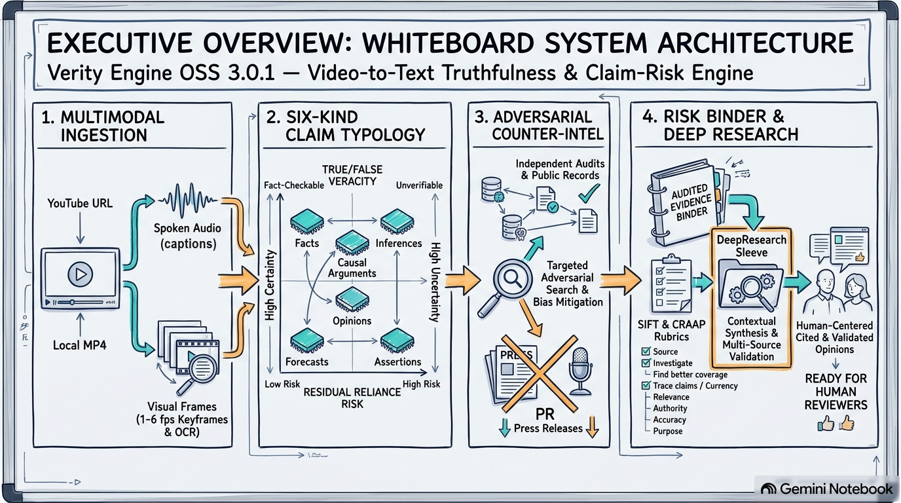

# Verity Engine OSS 3.0.1: Release Description & Syndication Kit

Official Launch Announcement Assets and Cross-Platform Distribution Kit

**Release Summary:** Verity Engine OSS 3.0.1 is an open-source video-to-text truthfulness and risk assessment application. This document provides publication-ready syndication copy tailored for technical communities (Hacker News, Reddit r/MachineLearning), professional networks (LinkedIn), and social broadcasting (X/Twitter thread), with install instructions for each channel.

**Claim scope used throughout this kit:** the 81 pixel-only claims are counted across 10 release runs (the 9 primary-10 videos that emitted exhibit maps plus the swapped-out CES restream); 69 of them fall within the final primary-10 battery of 342 claims.

***

## Part III. Cross-Platform Syndication Kit

### Hacker News (Show HN)
* **Title**: Show HN: Verity Engine OSS 3.0.1 – Video-to-text truthfulness and claim risk engine
* **Project Repository**: [https://github.com/hotchilianalytics/verityngn-oss](https://github.com/hotchilianalytics/verityngn-oss)
* **Body Text**:
We built Verity Engine OSS (Apache-2.0) to solve a fundamental problem in automated video analysis: transcript-only fact-checking is blind to visual evidence, and binary True/False scores fail on nuanced claims.

Verity Engine 3.0.1 is a video-to-text truthfulness and risk assessment app. You hand it a YouTube URL or local MP4 file, and it:
1. Concurrently extracts speech and visual text using adaptive 1–6 fps sampling and on-screen text extraction (across our 10 release runs, 81 claims were sourced only from pixels, 69 of them within the final 10-video battery; in an Oregon legislative hearing, 45% of claims were pixel-only).
2. Classifies statements across six epistemological types (facts, inferences, causal arguments, opinions, predictions, unverified assertions).
3. Executes counter-intelligence search queries designed to find disconfirming evidence while penalizing PR press releases.
4. Generates an audited Markdown/JSON/HTML dossier under SIFT or CRAAP rubrics.

CLI: `pip install 'verityngn[deep]==3.0.1'`
Gallery and documentation: [https://verityindex.com/gallery](https://verityindex.com/gallery)
Substack essay: [https://ajjcop.substack.com](https://ajjcop.substack.com)

### LinkedIn
* **Headline**: Announcing Verity Engine OSS 3.0.1: Video-to-Text Truthfulness & Risk Analysis
* **Body Text**:
Most automated fact-checking systems fail when applied to real-world video because they ignore half the medium. By relying strictly on audio transcripts, they miss financial tables, legislative slides, and silent disclaimer cards flashing on screen. Furthermore, slapping a binary True or False label onto complex executive commentary or economic forecasts is fundamentally flawed.

Today we are releasing Verity Engine OSS 3.0.1 under the Apache-2.0 license. Verity Engine is a dedicated video-to-text truthfulness and risk assessment engine. 

Key capabilities in 3.0.1:
- Multimodal Recognition: Combines multimodal speech understanding with adaptive 1–6 fps keyframe sampling and on-screen text extraction. Across our 10 release runs, 81 claims were sourced exclusively from on-screen pixels (69 within the final 10-video battery).
- Six Institutional Domain Packs: Expanded from consumer health VSLs to legislative analysis (Oregon SB 1507), executive broadcast interviews, and legal depositions.
- Six-Kind Claim Taxonomy: Separates empirical facts from forecasts and reasoned opinions, assigning actionable residual risk metrics rather than moralistic truth scores.
- Counter-Intelligence Retrieval: Intentionally searches for contradictory public records and independent audits.

Read the full release breakdown on Substack: [https://ajjcop.substack.com](https://ajjcop.substack.com)
Try the open-source CLI: `pip install 'verityngn[deep]==3.0.1'`

### X (Twitter Thread)
1. Today we are releasing Verity Engine OSS 3.0.1—an open-source video-to-text truthfulness and claim-risk engine. You feed it a YouTube link or local MP4; it extracts spoken and on-screen claims, verifies them against public evidence, and maps reliance risk.
2. Why not just transcribe and prompt an LLM? Because transcript-only fact-checking is blind. Across our 10 release runs, 81 claims were pixel-only (slides, charts, lower-thirds); 69 of those sit in the final primary-10 battery. In Oregon SB 1507, 18 of 40 claims (45%) came only from on-screen exhibits.
3. We also eliminate the binary truth score trap. Verity Engine splits claims into 6 types: Source-backed facts, Data-derived inferences, Causal arguments, Reasoned opinions, Predictions, and Unverified assertions. Forecasts carry reliance risk, not false scores.
4. Domain coverage has expanded beyond consumer health supplements into 6 institutional packs: Consumer VSLs (CRAAP), Legislative & Fiscal (SIFT), CEO & Exec Interviews, Sworn Legal Depositions, and Contested Health Science in the engine, plus Corporate Disclosures via the rfkit / ClearFactor companion.
5. Shipping in 3.0.1: `verityngn captions <url>` CLI diagnostic; auto-emitted `brand_safety_scores.json` and exhibit maps; clean dependency sleeves for vision and audio sensors; groundwork for 3.1 action semantics and 3.2 non-verbal congruence.
6. Everything that governs verification quality lives in the Apache-2.0 OSS core. Hosted scale, team galleries, and compliance workflows live on [https://verityindex.com](https://verityindex.com).
7. Read the complete technical release essay and view our Emergent Mind whiteboard architecture boards on Substack: [https://ajjcop.substack.com](https://ajjcop.substack.com). Install: `pip install 'verityngn[deep]==3.0.1'`.

### Reddit (r/MachineLearning)
* **Title**: [P] Verity Engine OSS 3.0.1: An open multimodal video-to-text truthfulness and claim-risk pipeline
* **Post Body**:
We have released version 3.0.1 of Verity Engine OSS, an Apache-2.0 open-core application designed for automated claim extraction, truthfulness verification, and reliance risk scoring from video inputs.

Traditional automated fact-checking suffers from two issues: transcript-only pipelines miss critical visual information, and binary True/False labeling fails on non-empirical statements.

Verity Engine pairs Gemini multimodal speech understanding (plus YouTube captions, with optional Groq Whisper ASR) with adaptive 1–6 fps frame sampling and on-screen text extraction. Across our 10 release runs, 81 claims were sourced exclusively from on-screen pixels; the final 10-video battery (342 total claims) accounts for 69 of them. In an analysis of an Oregon legislative hearing (Oregon SB 1507), 18 of 40 claims existed solely in projected slides and tables.

Claims are classified into a 6-part taxonomy (Fact, Inference, Causal Argument, Opinion, Prediction, Assertion). Counter-evidence search graphs intentionally down-weight PR/marketing domains and prioritize authoritative third-party records. Output reports are structured using genre-aware rubrics (SIFT or CRAAP).

Package: `pip install 'verityngn[deep]==3.0.1'`
Code: [https://github.com/hotchilianalytics/verityngn-oss](https://github.com/hotchilianalytics/verityngn-oss)
Release essay: [https://ajjcop.substack.com](https://ajjcop.substack.com)
