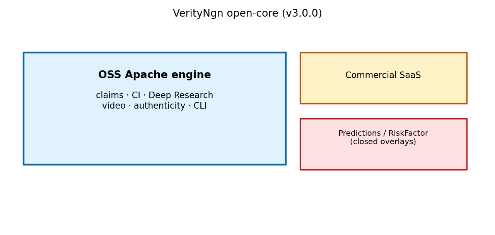
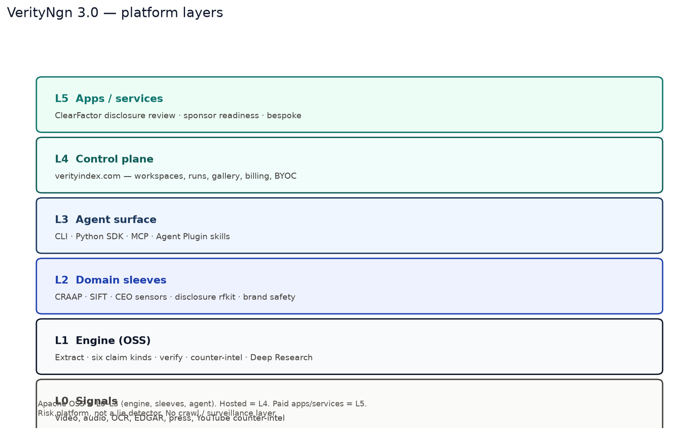
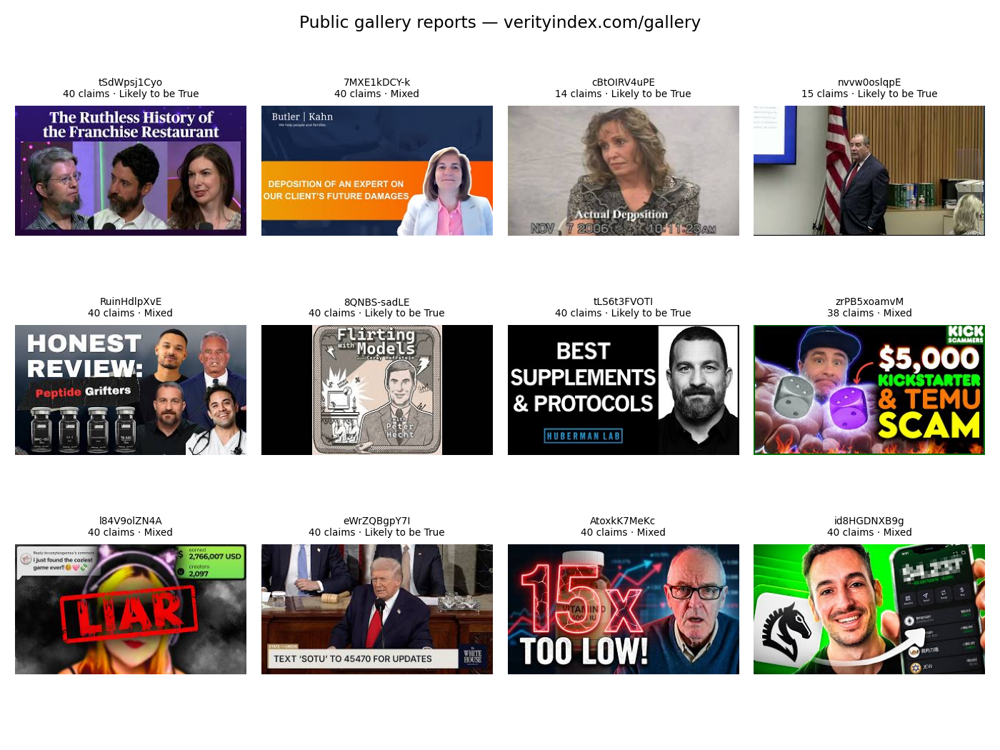
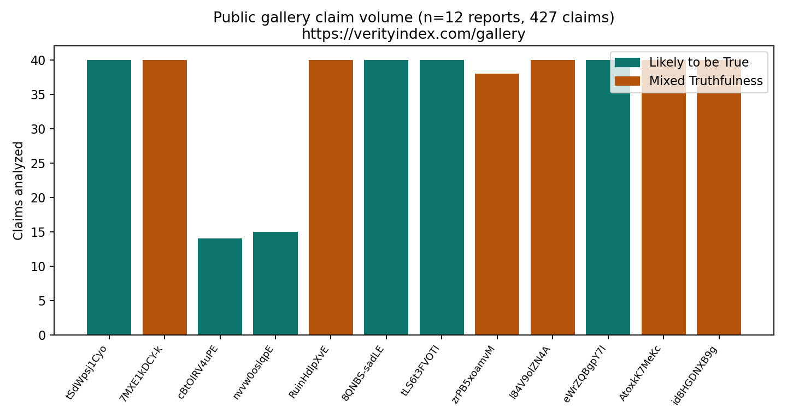
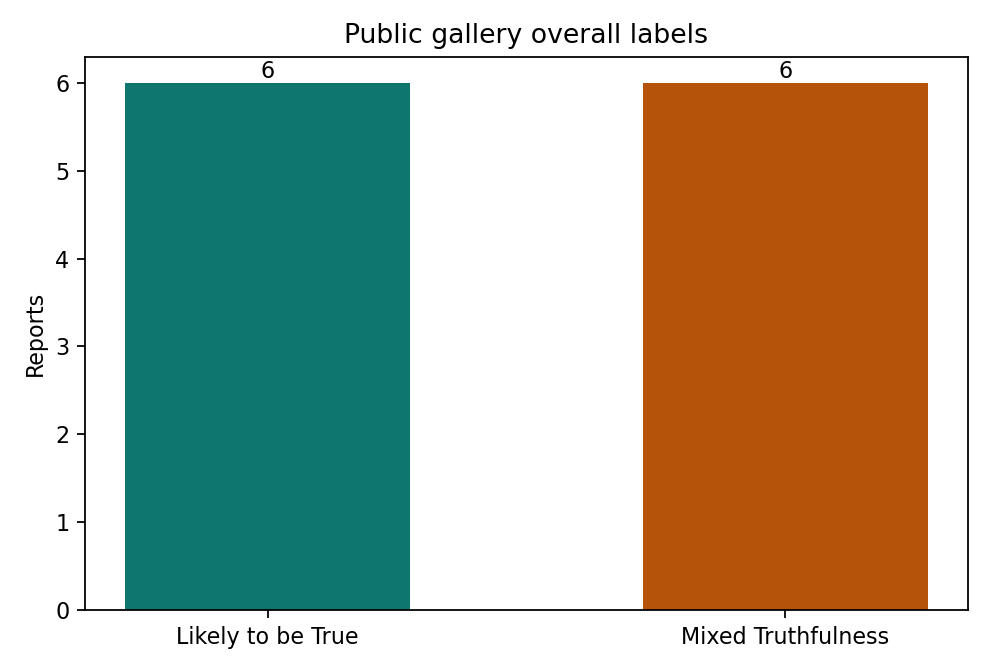
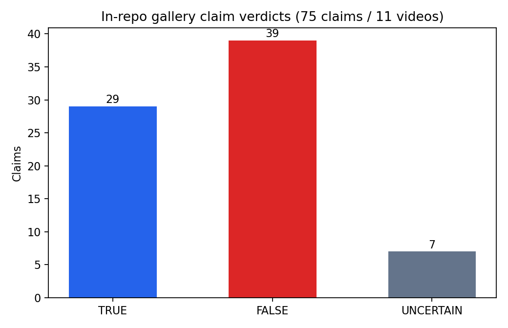
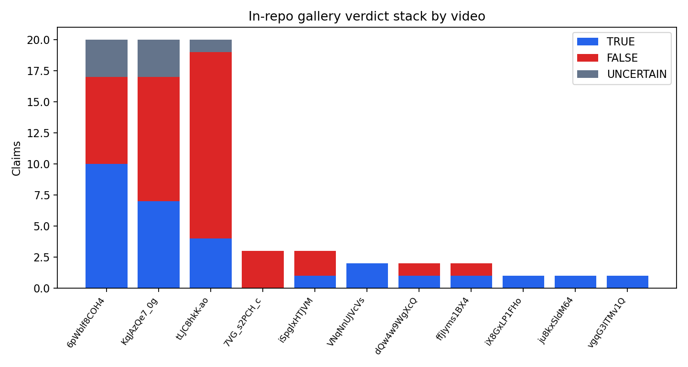
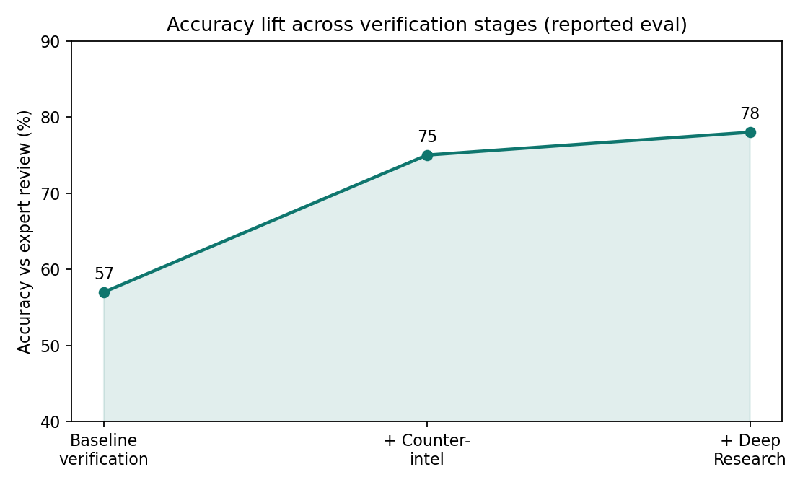

# VerityNgn OSS 3.0.1 — Public Engine Release Paper

**Authors:** HotChili Analytics / VerityNgn Research  
**Date:** 2026-11-13 (packaging cut 2026-11-10; engine tip 2026-08–11)  
**Version:** **3.0.1** on PyPI (`3.0.0` yanked — packaging hygiene) · engine tip `1b2cca8` · docs tip `f6aeb2e`  
**License:** Apache-2.0 (engine); commercial overlays under separate terms  
**Live gallery:** https://verityindex.com/gallery  
**PyPI:** https://pypi.org/project/verityngn/3.0.1/  
**GitHub engine cut:** https://github.com/hotchilianalytics/verityngn-oss/releases/tag/v3.0.0  

> Prefer the print HTML/PDF: build with `python scripts/build_release_paper_html.py`, then `bash scripts/render_release_paper_pdf.sh` (Chromium via Playwright — run outside Cursor).

---

## Abstract

We release **VerityNgn OSS 3.0.1**, a standalone open-source multimodal **claim-risk** engine installable from PyPI. The engine restores **Deep Research** to the Apache tree, ships six claim kinds and genre-aware CRAAP/SIFT, absorbs CEO **sensors** as `verityngn[predictions]`, and — on every `full` / `local-full` run — extracts **pixel-sourced claims** (on-screen text, graphics, charts, demos), adaptive **1–6 fps** sampling, and auto-written **brand-safety** / **exhibit-map** sidecars. Across 10 v3 release runs, **81** verified claims exist only in pixels (never spoken; **69** within the final primary-10 battery), including **45%** of SB1507 legislative claims. Opt-in sleeves (`[vision]`, `[audio]`, `[predictions]`, MultiSense) already ship in the wheel for face/prosody congruence research. verityindex.com is the hosted control plane; ClearFactor is the first paid disclosure app. We do not claim earnings prediction, allocation factors, or lie detection.

**Keywords:** video verification, counter-intelligence, deep research, open-core, multimodal LLM, brand safety, exhibit maps

---

## 1. Motivation

Prior open-core practice left Deep Research and several authenticity cues on the commercial fork, while OSS drifted. Public distribution requires an impressive, drop-in engine (`pip install verityngn`) that communities can run without SaaS.



*Figure 1. OSS Apache engine vs hosted control plane and paid apps.*



*Figure 1b. L0 signals through L5 apps. Apache owns L0–L3.*

---

## 2. System overview (v3 + v3.1 addendum)

### Analysis tiers (v3.1)

| Tier | Input | Pipeline | Typical latency |
|------|-------|----------|-----------------|
| `light` | YouTube URL | VTT → DR-direct | ~60s |
| `full` | YouTube URL | VTT cache + full CI/verify + optional DR | minutes |
| `local-light` | `.mp4` | sidecar transcript → DR-direct | ~60s |
| `local-full` | `.mp4` | full pipeline + optional DR | minutes |

```bash
verityngn analyze --tier light 'https://www.youtube.com/watch?v=VIDEO_ID'
verityngn analyze --tier full 'https://www.youtube.com/watch?v=VIDEO_ID' --deep
verityngn captions 'https://www.youtube.com/watch?v=VIDEO_ID'   # operator VTT debug
```

Caption reliability: cached `.en.vtt` / `.vendor.vtt` → yt-dlp (`player_client=android` + `cookies.txt`) → `youtube_transcript_api` → **Supadata** (opt-in `SUPADATA_API_KEY`) → Groq ASR (opt-in) → **Gemini YouTube URL** (`.gemini.vtt`). YouTube Data API metadata alone does **not** download third-party `.en.vtt`. See `docs/guides/YOUTUBE_CAPTIONS.md`. **T-TX-002 v2:** Supadata native **4/6** live (~8.6 s); yt-dlp **5/6**.

#### Why `.en.vtt` is not a simple API call (Sherlock T-VTT-001)

| Path | Works for public third-party videos? |
|------|--------------------------------------|
| YouTube Data API `videos.list` | Metadata only — no VTT |
| `captions.download` (OAuth) | **Owner-only** — 403 for others |
| `youtube_transcript_api` | Often **HTTP 200 + empty body** when PoToken (`&exp=xpe`) required |
| yt-dlp + android + cookies | Works when cookies fresh; SABR otherwise |
| Supadata (`SUPADATA_API_KEY`) | **Live (T-TX-002 v2):** native OK on captioned + Alphabet; free-tier 429 under burst; hard C4 generate pending |
| Gemini YouTube URL | Synthetic transcript — not official captions |

### §2.1 Ablation: VTT→DR vs report-JSON→DR (T-ABL-005)

**Hypothesis:** Deep Research from cached `.en.vtt` + DR-direct (`--tier light`) is faster but misses the structured claim inventory that full pipeline + DR consumes.

**Seed:** `tLJC8hkK-ao` (Lipozem VSL — spoken-heavy; cite as weak multimodal proof per T-ABL-004).

| Arm | Input | DR elapsed | Claims in payload | `[Reference:]` count | Topic Jaccard vs other arm |
|-----|-------|------------|-------------------|----------------------|----------------------------|
| **VTT → DR** | 50,003-char cached `.en.vtt` | **15 s** | 0 | 12 | — |
| **JSON → DR** | `{id}_report.json` (40 verified claims) | **20 s** | 40 | 23 | **0.22** |

**Decision:** `keep_full_default` — DR-only on transcript is ~3× faster than full pipeline+DR (892 s in T-ABL-001) but lexical overlap with inventory-grounded DR remains low. Light tier is a **triage path**, not a replacement for audit/CI.

Full pipeline + DR (T-ABL-001): topic Jaccard **0.058** between full standard report MD and DR-direct without transcript (v2 bug); with VTT loaded, VTT→DR vs JSON→DR Jaccard rises to **0.22** but still supports keeping full as default.

Artefact: `outputs/ablation_vtt_json_dr_tL_v3/compare_vtt_json_dr.json` · script: `scripts/run_vtt_json_dr_ablation.py`.

### Adaptive vision & pixel risk (live in 3.0.1)

Genre-aware FPS/resolution sampling (`services/vision/adaptive_sampler.py`) is **default-on** for segmented GenAI/Vertex analysis when a local probe or `VIDEO_GENRE_HINT` is available:

| Scene class | Typical fps | Resolution | When |
|-------------|-------------|------------|------|
| `lecture_vsl` | **1.0** | LOW | Talking-head / standard VSL |
| `montage_motion` | **3.0** | MEDIUM | High cut density |
| `exhibit_slide` | **4.0** | HIGH | Depositions, hearings, earnings slides |
| `flash_ocr` | **6.0** | HIGH | Ads, Shorts, UGC supers |

`--tier auto` uses optical `visual_text_density` to escalate slide-heavy videos out of transcript-only mode. Ablation **T-ABL-006** (earnings / UGC / exhibit seeds): multimodal adds unique claims on **3/3** captioned seeds; only-MM share of the claim union **0.67–0.74**.

#### Pixel-sourced claims on the v3 release benchmark

Every claim carries `source_type` ∈ `{spoken, visual_text, graphic, chart, demonstration}`. Across `outputs/release_v3_*` exhibit maps (**81** pixel-only claims across 10 release runs; **69** within the final primary-10 battery):

| Source type | Count | Role |
|-------------|-------|------|
| `visual_text` | 43 | Lower-thirds, authority cards, OCR supers |
| `graphic` | 23 | Spec slides, deal graphics, LRO figures |
| `chart` | 11 | Tables / projected revenue charts |
| `demonstration` | 4 | Physical / on-camera actions (under-extracted today) |

**Examples (already verified):** SB1507 local dense — **18/40 (45%)** visual (e.g. `$178.4M` LRO graphic, `+$311.6M` table); Lipozem `tLJC8hkK-ao` — **5** silent testimonial/doctor cards; Peptides `RuinHdlpXvE` — **13**; Butler Kahn deposition `7MXE1kDCY-k` — **12**; CES keynote `fuq0Ncdsknk` — **12** GPU-spec slides; CNBC `ijRuuaaM6XM` — **10** market-board graphics.

#### Auto-written visual risk sidecars (every full run)

- **`brand_safety_scores.json`** — `visual_only_high_risk_count` (one contested visual-only claim → `reject`), `credential_flash_events` (flashed MD/PhD/Harvard-class badges), sub-1000 ms `#ad` / sponsored overlays → elevated affiliate risk.
- **`{video_id}_exhibit_map.json`** — timestamped visual exhibit ledger (`ocr_snippet`, `bates_guess`, optional bbox / on-screen ms).
- Deep Research (`--deep`) receives `visual_only_claims` and is instructed to lead with pixel-only risk findings.

```
Video URL or file
  → (optional) VTT cache via caption_fetch
  → adaptive 1–6 fps multimodal analysis + claim extraction (spoken + visual)
  → counter-intelligence (YouTube / press-release / Sherlock CI)
  → probabilistic verification (TRUE / FALSE / UNCERTAIN)
  → standard report + brand_safety_scores.json + exhibit_map.json
  → optional Deep Research (grounded pass; visual_only_claims first)
  → optional authenticity / spectral / Face Landmarker / MultiSense (extras)
```

### Deep Research (now in OSS)

`verityngn analyze <url> --deep` produces `{video_id}_deep_private_report.{md,html,pdf}` plus grounding audit JSON.

### Opt-in sleeves already in the 3.0.1 wheel (not default `analyze`)

| Extra / flag | What it measures |
|--------------|------------------|
| `verityngn[vision]` | MediaPipe Face Landmarker (478 landmarks, 52 blendshapes), `hfasy_proxy`, blink/gaze, `--story-arc` continuity |
| `verityngn[audio]` | Prosody / exuberance / disfluency; spectral TTS / synthetic-voice indicators |
| `verityngn[predictions]` + `MULTISENSE_ENABLED=1` | S00–S15 delivery/instrument sensors; Gemini Tier A/B clip congruence |
| `VN_AGENTIC_VIDEO=1` | Gemini `mediaProcessing=AGENTIC` frame search spike |
| Authenticity gate | Fail-closed C2PA / CorSound / visual / rPPG before affect scoring |

### Explicitly out of *default* 3.0.1 analyze (hosted or deferred product)

Hosted trial credits / Stripe, CAR/ICIR event-study promotion, Family B allocation alpha, and default-on object/action semantics + pose/lip congruence (see §8 Futures — turning on in **3.1 / 3.2** atop the sleeves above).

---

## 3. Live gallery evidence (verityindex.com)

Scraped **2026-08-29** from https://verityindex.com/gallery:

| Metric | Value |
|--------|-------|
| Public reports | **12** |
| Claims analyzed | **427** |
| Likely to be True | 6 reports |
| Mixed Truthfulness | 6 reports |



*Figure 2. Public gallery cards (YouTube thumbnails).*



*Figure 3. Claims analyzed per public gallery report.*



*Figure 4. Overall gallery labels.*

Machine-readable snapshot: [`figures/gallery_live_stats.json`](figures/gallery_live_stats.json).

Editorial labels on the gallery are HotChili Analytics LLM assessments — **not** YouTube data.

---

## 4. In-repo gallery claim mix

From `ui/gallery/approved/` report JSONs (claim-level verification fields):

| Metric | Value |
|--------|-------|
| Videos | 11 |
| Claims with verdicts | 75 |
| TRUE / FALSE / UNCERTAIN | 29 / 39 / 7 |



*Figure 5. Claim-level verdict mix (in-repo approved gallery).*



*Figure 6. Per-video stacked verdicts.*



*Figure 7. Prior evaluation narrative: accuracy lift across stages.*

---

## 5. Install & CLI

```bash
pip install 'verityngn[deep]==3.0.1'
# optional sleeves:
# pip install 'verityngn[vision,audio,predictions]==3.0.1'
verityngn analyze --tier full --deep 'https://www.youtube.com/watch?v=VIDEO_ID'
verityngn analyze --tier light 'https://www.youtube.com/watch?v=VIDEO_ID'
verityngn analyze --file deposition.mp4 --title "Matter clip" --tier local-full --deep
```

Prefer **`3.0.1`**. Do not pin yanked `3.0.0`. Credentials: Vertex ADC or `VERITY_GEMINI_KEY` / `GEMINI_API_KEY` (see `.env.example`). Keep GCP SA JSON **outside** the installable package tree. Captions: `YTDLP_COOKIES` or repo `cookies.txt`.

---

## 6. Open-core dependency model

Hosters pin **OSS ≥3.0.1** (or ≥3.0.0 engine tip). Research sleeves (`services/predictions`, `quant`, `fusion`, `affect`, vision extractors) are **first-class Apache OSS**. Boundary CI fails on **commercial markers** (Stripe, trial credits, commercial gallery prefixes) — not on research package names. See `docs/OPEN_CORE.md`.

---

## 7. What we will not claim

- No earnings prediction or allocation alpha
- No “lie detector” branding
- No employment / HR / education screening use of face or affect cues (EU AI Act Art. 5(1)(f))

---

## 8. Futures: merging prior research with multimodal scene & congruence risk (3.1 / 3.2)

**Roadmap (honest):** Visual Text / Exhibits & Brand-Safety (**live in 3.0.1**) → Object / Action Semantics, Visual–Spoken Contradiction, and Cross-Modal Pose / Lip / Audio Congruence (**default-on in 3.1 / 3.2** on top of MediaPipe + MultiSense sleeves already in the repo).

### Foundational threads being unified

| Heritage | What we keep |
|----------|--------------|
| Spot Runner Plutchik arcs | `sr_*` emotional-index leaves in fusion schema |
| Mayew & Venkatachalam (JF 2012); Qin & Yang (ACL 2019) | Q&A reactivity (`S05`), pace/pitch escalation (`S08`) |
| Banker et al. (*Management Science* 2024) | Hemifacial asymmetry → `HFAsy_proxy` (`S12`) |
| Blankespoor et al.; Oxford-Man | Expression–news incongruence (`S13`); cross-modal distance (`S01`) |
| Krykoniuk et al. (*Nature HSS Comms* 2026) | Discourse derailment (`S11`) |
| Kim / Muhn / Nikolaev | Transcript/filing disclosure risk (`S15` → ClearFactor / rfkit) |
| Negative-result hygiene | Refuse near-chance vocal dissonance (`S14`); ban synthetic `0.5` vision fills; within-speaker baselines; fail-closed provenance (`S00`) |

### New work turning default-on

1. **Object / prop / action semantics** — extraction prompts today bias OCR/charts and suppress “decorative” visuals (hence **4/81** `demonstration` claims). 3.1 expands to physical demos, before/after lighting/posture tricks, sped-up motion, and venue framing at 1–6 fps + optional `AGENTIC` frame search.  
2. **Visual–spoken contradiction & temporal splice risk** — pair silent supers / chart axes / jump-cuts against spoken assurances mid-claim.  
3. **Default-on pose / lip / face / audio congruence** — promote MediaPipe + MultiSense + prosody into a calibrated delivery/conviction track (never veracity).

Public launch target for this packaging narrative: **Monday 16 Nov 2026**.

---

## Changelog pointer

See repository `CHANGELOG.md` → `[3.0.1] - 2026-11-10` (packaging / security) and `[3.0.0] - 2026-08-29` (engine feature cut).
